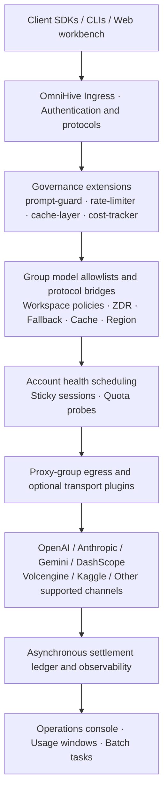

<p align="center"></p>

# OmniHive AI Gateway

[English](README.md) · [简体中文](README.zh-CN.md)

A self-hosted AI gateway for routing requests across provider accounts and tracking usage and charges by project.

[](https://github.com/guanwenpeng2001-bot/OMNIHIVE-AI-GW/actions/workflows/backend-ci.yml)
[](https://github.com/guanwenpeng2001-bot/OMNIHIVE-AI-GW/releases/latest)
[](LICENSE)
[](backend/go.mod)
[](frontend/pnpm-lock.yaml)

## Features

- Serve OpenAI Chat and Responses, Anthropic Messages and Gemini requests. Endpoint availability depends on the model and provider account.
- Route across eligible account pools using model access, health, affinity and fallback policies. Inspect candidate selection in the console.
- Track quotes, decimal ledger entries and request receipts. Inspect requests with incomplete usage evidence during reconciliation.
- Manage workspace and project access, budgets and bring-your-own-key (BYOK) credentials.
- Browse models and pricing in the Model Plaza. Run requests from the Playground with a project key and a verified connection.
- Extend the gateway with signed WASI plugin packages. Monitor usage, request attempts and asynchronous media tasks in the console.
- Install binary updates from GitHub Releases and roll back to eligible versions from the console.

## Architecture



PostgreSQL stores application data and settlement records. Redis supports caching and coordination.

## Quick start

### Docker Compose

Install Docker Engine and Docker Compose 2.24+. These commands build a local image:

```bash
git clone 'https://github.com/guanwenpeng2001-bot/OMNIHIVE-AI-GW.git'
cd OMNIHIVE-AI-GW
cp deploy/.env.example deploy/.env
```

Edit `deploy/.env` to configure database credentials, the administrator account and persistent secrets, then build and start:

```bash
docker build -t 'ghcr.io/guanwenpeng2001-bot/omnihive-ai-gw:latest' .
docker compose --project-directory deploy -f deploy/docker-compose.yml config --quiet
docker compose --project-directory deploy -f deploy/docker-compose.yml up -d
docker compose --project-directory deploy -f deploy/docker-compose.yml logs -f omnihive
```

Open `http://localhost:8080`.

### One-click deployment

From the repository root, prepare a fresh deployment directory. The script downloads the directory-backed Compose configuration and creates an environment file with generated secrets. Set `OMNIHIVE_RELEASE_TAG` to select a published release.

```bash
script="$PWD/deploy/docker-deploy.sh"
mkdir ../omnihive-deployment
cd ../omnihive-deployment
bash "$script" && docker compose up -d
```

## Upgrading

Back up PostgreSQL, application data and persistent keys. For binary installations, select the version badge in the admin console to install a full GitHub Release or choose an eligible rollback version. Binary rollback preserves the current database schema. For image deployments, run the following in the directory containing your active Compose file, then check /health and /ready.

```bash
docker compose pull
docker compose up -d
```

## Configuration

| Variable | Purpose |
| --- | --- |
| `POSTGRES_PASSWORD` | Password for the bundled PostgreSQL service |
| `JWT_SECRET` | Persistent login-token signing secret; retain across container replacements |
| `TOTP_ENCRYPTION_KEY` | Persistent two-factor authentication encryption key; include in protected backups |
| `ADMIN_EMAIL` / `ADMIN_PASSWORD` | Initial administrator settings |
| `BIND_HOST` / `SERVER_PORT` | Host bind address and published port; Compose keeps internal port 8080 |
| `UPDATE_GITHUB_TOKEN` | Optional credential for private repository Release metadata and assets |
| `DATABASE_*` / `REDIS_*` | External service connection settings described in the environment template |

Generate signing and encryption secrets separately with `openssl rand -hex 32` and protect `.env`. Persist `/app/data`, PostgreSQL data and Redis data. Use `deploy/docker-compose.standalone.yml` for external dependencies or `deploy/docker-compose.local.yml` for directory-backed storage. See the [deployment guide](deploy/README.md) and [image documentation](deploy/DOCKER.md).

## Documentation

| Document | Contents |
| --- | --- |
| [Development guide](DEV_GUIDE.md) | Local development, builds, migrations, plugins and conventions |
| [Usage guide](docs/usage-guide.md) | API keys, client configuration and request examples |
| [Provider configuration](docs/provider-configuration.md) | Provider and account setup |
| [Protocol matrix](docs/gateway-platform-protocol-matrix.md) | Platform, model and endpoint boundaries |
| [Composite groups](docs/COMPOSITE_GROUPS.md) | Group composition and routing |
| [Asynchronous image tasks](docs/ASYNC_IMAGE_TASKS.md) | Queues, tasks, retries and downloads |
| [Plugin development](contracts/plugins/README.md) | `.ohplugin` v2 manifests, signatures, WASI runtime and migration |
| [Payment configuration](docs/PAYMENT.md) | Neutral payment integration and webhook setup |
| [Deployment and operation commitment](docs/legal/admin-compliance.en.md) | Instance operator responsibilities |

## Development

[Developer guide](DEV_GUIDE.md) · [Contributing](CONTRIBUTING.md) · [Changelog](CHANGELOG.md)

## Security

[Report a vulnerability privately](SECURITY.md)

## License and acknowledgements

OmniHive is derived from sub2api by Wei-Shaw and contributors and is distributed under LGPL-3.0. [LICENSE](LICENSE) · [NOTICE](NOTICE)
