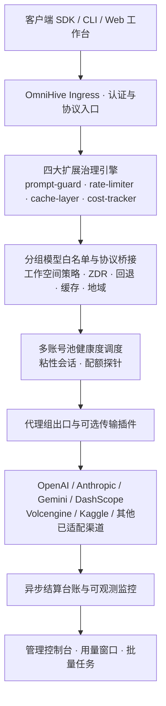

<p align="center">
  
</p>

# OmniHive AI Gateway (OMNIHIVE-AI-GW)

现有部署升级前请参阅[部署身份迁移说明](docs/refactor/IDENTITY_MIGRATION.md)。

<p align="center"><strong>「智能算力中转蜂巢 · 企业级多模态 AI 统一网关与治理中枢」</strong></p>
<p align="center">
  
  
  
  
  
  
</p>

[简体中文](README.md) | [English](README_EN.md)

## 项目定位与核心特性

OmniHive 面向需要统一管理多供应商、多账号和多模态 AI 调用的团队，提供协议入口、路由治理、用量结算与运维控制台。仓库标识为 `OMNIHIVE-AI-GW`，项目地址为 [GitHub](https://github.com/guanwenpeng2001-bot/OMNIHIVE-AI-GW)。

- **多协议原生接入**：OpenAI Chat / Responses / Realtime、Anthropic Messages、Google Gemini v1beta、Codex CLI，以及 DashScope、Volcengine、Kaggle 多模态通道。实际可用端点取决于平台、账号类型、模型白名单和上游授权，详见[协议矩阵](docs/gateway-platform-protocol-matrix.md)。
- **智能分组调度与粘性会话**：按分组、模型访问规则和账号健康度分配请求，配合会话亲和性与代理组出口，管理多账号池。
- **上游配额探针与实时用量窗口**：结合上游可用额度、本地调用台账和运行状态，辅助容量规划、故障定位与成本管理。
- **工作空间路由策略**：按渠道能力配置 ZDR、自动回退、提示词缓存与地域偏好；策略是否可执行以对应上游协议和账号能力为准。
- **批量生图工作台**：异步队列、任务状态追踪、失败子项重试与 ZIP 打包下载，支持可追踪的多模态生产流程。
- **传输插件与内置扩展**：`.ohplugin` 为签名、隔离运行的 v2 传输插件包；旧 `.s2plugin` 仅在迁移兼容窗口内验签导入。`prompt-guard`、`rate-limiter`、`cache-layer`、`cost-tracker` 四大内置网关扩展承担提示词治理、限流、缓存与成本追踪。
- **面板更新与回滚**：管理员通过左上角版本徽标检查 GitHub Release、执行更新或选择允许回滚的版本。

## 系统架构概览



同步请求、流式响应和异步任务共享鉴权与计费边界，但各自遵循对应协议的生命周期。PostgreSQL 保存业务数据与结算记录，Redis 支撑缓存、队列和协调；能力边界与例外见专题文档。

## 快速开始

### Docker Compose

准备 Docker Engine 与 Docker Compose 2.24+。以下命令使用本地构建镜像：

```bash
git clone 'https://github.com/guanwenpeng2001-bot/OMNIHIVE-AI-GW.git'
cd OMNIHIVE-AI-GW
cp deploy/.env.example deploy/.env
```

编辑 `deploy/.env`，设置数据库密码、管理员账号和持久化密钥，然后构建与启动：

```bash
docker build -t 'ghcr.io/guanwenpeng2001-bot/omnihive-ai-gw:latest' .
docker compose --project-directory deploy -f deploy/docker-compose.yml config --quiet
docker compose --project-directory deploy -f deploy/docker-compose.yml up -d
docker compose --project-directory deploy -f deploy/docker-compose.yml logs -f omnihive
```

访问 `http://localhost:8080` 完成初始化。仓库 owner 占位符需由部署环境解析为实际值，镜像地址也需按实际 GHCR 命名空间配置。已有发布镜像时可省略本地构建，先执行相同 Compose 配置的 `pull` 命令。

| 环境变量 | 用途 |
| --- | --- |
| `POSTGRES_PASSWORD` | Compose 内置 PostgreSQL 密码，部署前必须设置 |
| `JWT_SECRET` | 固定的登录令牌签名密钥，重建容器时保持不变 |
| `TOTP_ENCRYPTION_KEY` | 固定的双因素认证加密密钥，备份时一并保存 |
| `ADMIN_EMAIL` / `ADMIN_PASSWORD` | 初始管理员配置 |
| `BIND_HOST` / `SERVER_PORT` | 主机监听地址与发布端口；Compose 容器内部仍使用 8080 |
| `UPDATE_GITHUB_TOKEN` | 可选，用于访问私有仓库的 Release 元数据与资产 |
| `DATABASE_*` / `REDIS_*` | 独立部署连接参数，参见环境模板 |

用 `openssl rand -hex 32` 分别生成签名与加密密钥，并保护 `.env`。保留 `/app/data`、PostgreSQL 与 Redis 持久化数据。外部数据库使用 `deploy/docker-compose.standalone.yml`，本地目录存储使用 `deploy/docker-compose.local.yml`。详见[部署指南](deploy/README.md)与[镜像说明](deploy/DOCKER.md)。

### 源码编译

工具链以 `backend/go.mod` 和 `frontend/package.json` 为准：Go 1.27.0、Node.js 24、pnpm 11。先构建前端，再嵌入后端：

```bash
pnpm --dir frontend install --frozen-lockfile
pnpm --dir frontend build
cd backend
go test -tags=unit ./...
go build -tags embed -o ../omnihive ./cmd/server
cd ..
```

准备 PostgreSQL / Redis，并按 `deploy/config.example.yaml` 配置服务连接；可将配置放到运行目录的 `config.yaml`。运行 `./omnihive`，详见[开发指南](DEV_GUIDE.md)。

### 二进制部署

从 [Releases](https://github.com/guanwenpeng2001-bot/OMNIHIVE-AI-GW/releases) 下载目标系统与架构的完整发行包和 `checksums.txt`，核对 SHA-256 后解压。也可先下载并审阅安装脚本：

```bash
curl -fL --globoff 'https://raw.githubusercontent.com/guanwenpeng2001-bot/OMNIHIVE-AI-GW/main/deploy/install.sh' -o install.sh
less install.sh
sudo bash install.sh
```

安装器保留既有服务名与二进制路径，以兼容已部署实例。使用私有仓库时，通过受保护的运行环境传入 `UPDATE_GITHUB_TOKEN`。安装细节、服务管理与备份流程见[部署指南](deploy/README.md)。

## 自动发布与面板一键更新

推送 `v*` 标签会触发 GitHub Actions Release 工作流；完整发布流程构建发行资产、校验清单和镜像。仅镜像的简化发布不提供面板自更新所需的完整二进制资产。

在管理后台左上角点击版本号，检查 Release 并选择更新；发布资产携带 `checksums.txt` 时，更新器执行 SHA-256 校验，再替换二进制。更新后通过受监督的进程重启恢复服务；容器应配置重启策略，原生部署应由 systemd 等进程管理器负责拉起。重启可能中断在途请求，安排维护窗口并检查 `/health` 与 `/ready`。可从面板选择允许回滚的历史版本；二进制回滚不会撤销数据库迁移，因此升级前应备份数据库与持久化密钥。

私有仓库配置 `UPDATE_GITHUB_TOKEN`，并确认该令牌拥有目标仓库的读取权限。发布与回滚行为还取决于实际工作流、资产命名和运行权限；详见[开发指南](DEV_GUIDE.md)。

## 目录结构与开发指南

```text
OMNIHIVE-AI-GW/
├── assets/                 # OmniHive 品牌资源
├── backend/                # Go 服务、Ent 数据模型与迁移
├── frontend/               # Vue 3 + TypeScript 管理与用户界面
├── deploy/                 # Compose、安装器与配置模板
├── docs/                   # 协议、业务能力与运维专题
└── DEV_GUIDE.md             # 开发环境、测试与贡献约定
```

| 文档 | 内容 |
| --- | --- |
| [开发指南](DEV_GUIDE.md) | 本地运行、构建、迁移、插件与代码约定 |
| [使用指南](docs/usage-guide.md) | API Key、客户端配置与调用示例 |
| [渠道配置](docs/provider-configuration.md) | 供应商与账号接入 |
| [协议矩阵](docs/gateway-platform-protocol-matrix.md) | 平台、模型和端点能力边界 |
| [组合分组](docs/COMPOSITE_GROUPS.md) | 分组组合与路由规则 |
| [批量生图](docs/BATCH_IMAGE_MVP.md) / [异步图像任务](docs/ASYNC_IMAGE_TASKS.md) | 队列、任务、重试与下载 |
| [插件开发](contracts/plugins/README.md) | `.ohplugin` v2 清单、签名、WASI 运行时与迁移 |
| [支付配置](docs/PAYMENT_CN.md) | 中立的支付渠道接入与回调配置 |
| [部署与运营说明](docs/legal/admin-compliance.zh.md) | 实例管理者责任说明 |

许可证见 [LICENSE](LICENSE)。
