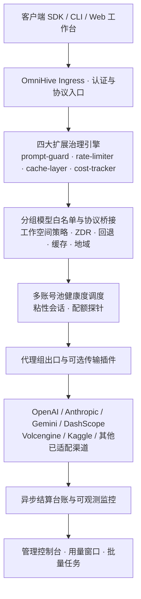

<p align="center"></p>

# OmniHive AI Gateway

[English](README.md) · [简体中文](README.zh-CN.md)

自托管 AI 网关，支持跨供应商账号路由请求，并按项目追踪用量与费用。

[](https://github.com/guanwenpeng2001-bot/OMNIHIVE-AI-GW/actions/workflows/backend-ci.yml)
[](https://github.com/guanwenpeng2001-bot/OMNIHIVE-AI-GW/releases/latest)
[](LICENSE)
[](backend/go.mod)
[](frontend/pnpm-lock.yaml)

## 功能

- 支持 OpenAI Chat 与 Responses、Anthropic Messages 和 Gemini 请求，可用端点取决于模型与供应商账号。
- 按模型权限、账号健康状态、会话亲和性与回退策略选择账号池，可在控制台查看候选账号的筛选结果。
- 查看预估费用、十进制账本分录与请求回执，在对账时核查用量证据不完整的请求。
- 管理工作空间与项目权限、预算及自带供应商密钥（BYOK）。
- 在模型广场浏览模型与价格，使用项目密钥和已验证连接在 Playground 发起请求。
- 通过签名的 WASI 插件包扩展网关，在控制台查看用量、请求尝试与异步媒体任务。
- 在控制台从 GitHub Releases 安装二进制更新，或回滚到符合条件的版本。

## 系统架构



PostgreSQL 保存业务数据和结算记录，Redis 提供缓存与协调。

## 快速开始

### Docker Compose

准备 Docker Engine 与 Docker Compose 2.24+。以下命令使用本地构建镜像：

```bash
git clone 'https://github.com/guanwenpeng2001-bot/OMNIHIVE-AI-GW.git'
cd OMNIHIVE-AI-GW
cp deploy/.env.example deploy/.env
```

编辑 `deploy/.env`，设置数据库密码、管理员账号和持久化密钥，然后构建与启动：

```bash
docker build -t 'ghcr.io/guanwenpeng2001-bot/omnihive-ai-gw:latest' .
docker compose --project-directory deploy -f deploy/docker-compose.yml config --quiet
docker compose --project-directory deploy -f deploy/docker-compose.yml up -d
docker compose --project-directory deploy -f deploy/docker-compose.yml logs -f omnihive
```

打开 `http://localhost:8080`。

### 一键部署

从仓库根目录开始，在新目录中准备部署。脚本下载使用本地目录持久化的 Compose 配置，并生成包含随机密钥的环境文件。可通过 `OMNIHIVE_RELEASE_TAG` 选择已发布版本。

```bash
script="$PWD/deploy/docker-deploy.sh"
mkdir ../omnihive-deployment
cd ../omnihive-deployment
bash "$script" && docker compose up -d
```

## 升级

先备份 PostgreSQL、应用数据与持久化密钥。二进制部署可点击管理控制台的版本号，安装完整的 GitHub Release 或选择可回滚版本。二进制回滚会保留当前数据库结构。镜像部署请在所用 Compose 文件所在目录执行以下命令，然后检查 /health 与 /ready。

```bash
docker compose pull
docker compose up -d
```

## 配置

| 环境变量 | 用途 |
| --- | --- |
| `POSTGRES_PASSWORD` | Compose 内置 PostgreSQL 密码，部署前必须设置 |
| `JWT_SECRET` | 固定的登录令牌签名密钥，重建容器时保持不变 |
| `TOTP_ENCRYPTION_KEY` | 固定的双因素认证加密密钥，备份时一并保存 |
| `ADMIN_EMAIL` / `ADMIN_PASSWORD` | 初始管理员配置 |
| `BIND_HOST` / `SERVER_PORT` | 主机监听地址与发布端口；Compose 容器内部仍使用 8080 |
| `UPDATE_GITHUB_TOKEN` | 可选，用于访问私有仓库的 Release 元数据与资产 |
| `DATABASE_*` / `REDIS_*` | 独立部署连接参数，参见环境模板 |

用 `openssl rand -hex 32` 分别生成签名与加密密钥，并保护 `.env`。保留 `/app/data`、PostgreSQL 与 Redis 持久化数据。外部数据库使用 `deploy/docker-compose.standalone.yml`，本地目录存储使用 `deploy/docker-compose.local.yml`。详见[部署指南](deploy/README.md)与[镜像说明](deploy/DOCKER.md)。

## 文档索引

| 文档 | 内容 |
| --- | --- |
| [开发指南](DEV_GUIDE.md) | 本地运行、构建、迁移、插件与代码约定 |
| [使用指南](docs/usage-guide.md) | API Key、客户端配置与调用示例 |
| [渠道配置](docs/provider-configuration.md) | 供应商与账号接入 |
| [协议矩阵](docs/gateway-platform-protocol-matrix.md) | 平台、模型和端点能力边界 |
| [组合分组](docs/COMPOSITE_GROUPS.md) | 分组组合与路由规则 |
| [异步图像任务](docs/ASYNC_IMAGE_TASKS.md) | 队列、任务、重试与下载 |
| [插件开发](contracts/plugins/README.md) | `.ohplugin` v2 清单、签名、WASI 运行时与迁移 |
| [支付配置](docs/PAYMENT_CN.md) | 中立的支付渠道接入与回调配置 |
| [部署与运营说明](docs/legal/admin-compliance.zh.md) | 实例管理者责任说明 |

## 开发

[开发指南](DEV_GUIDE.md) · [贡献指南](CONTRIBUTING.md) · [版本记录](CHANGELOG.md)

## 安全

[私下报告安全漏洞](SECURITY.md)

## 许可证与致谢

OmniHive 派生自 Wei-Shaw 与贡献者开发的 sub2api，使用 LGPL-3.0 许可证。 [LICENSE](LICENSE) · [NOTICE](NOTICE)
