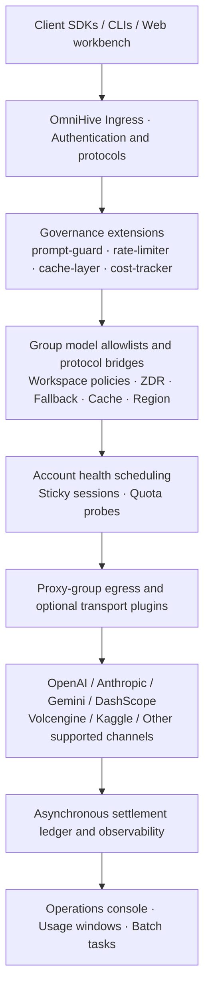

<p align="center">
  
</p>

# OmniHive AI Gateway (OMNIHIVE-AI-GW)

For existing installations, see the [deployment identity migration guide](docs/refactor/IDENTITY_MIGRATION.md).

<p align="center"><strong>OmniHive — Unified AI Inference Gateway</strong></p>
<p align="center"><strong>An intelligent compute hive · Enterprise multimodal AI gateway and governance platform</strong></p>
<p align="center">
  
  
  
  
  
  
</p>

[简体中文](README.md) | [English](README_EN.md)

## Purpose and core capabilities

OmniHive (`OMNIHIVE-AI-GW`) is an enterprise-grade unified AI inference gateway providing multi-protocol ingress, deterministic routing governance, exact decimal ledger settlement, workspace/project RBAC with BYOK, and full-lifecycle observability: [GitHub repository](https://github.com/guanwenpeng2001-bot/OMNIHIVE-AI-GW).

- **Native protocol access**: OpenAI Chat / Responses / Realtime, Anthropic Messages, Google Gemini v1beta, Codex CLI, and multimodal channels including DashScope, Volcengine and Kaggle. Endpoint availability depends on platform, account type, model allowlists and upstream authorization; consult the [protocol matrix](docs/gateway-platform-protocol-matrix.md).
- **Five-step connection wizard & egress pools**: Guided onboarding (Provider & Schema → Credentials → Live Probe → Diff Preview → Activate), custom outbound header overrides, and dedicated egress proxy pools.
- **Routing workbench & Route Explain**: Scoped routing policies (ZDR, automatic fallback, prompt caching, regional residency), shadow simulation, and deterministic candidate scoring traces.
- **Exact decimal ledger & authoritative quotes**: Arbitrary-precision decimal accounting, server-side `POST /quotes` preflight estimation, project budgets, and reconciliation workflows.
- **Workspace / Project RBAC & BYOK**: Optimistic-concurrency (`ETag` / `If-Match`) member grants and self-managed customer provider credentials (BYOK) at workspace and project scopes.
- **Public Model Plaza, Request Waterfall & Task Center**: Live public catalog and pricing projection, end-to-end attempt waterfall diagnostics, and asynchronous multimodal task orchestration.
- **Group scheduling and sticky sessions**: Allocate requests using group rules, model access and account health, with session affinity and proxy-group egress across account pools.
- **Quota probes and live usage windows**: Combine upstream quota availability, local usage records and runtime status to support capacity planning, incident investigation and cost management.
- **Batch image workbench**: Asynchronous queues, task tracking, failed-item retries and ZIP downloads for traceable multimodal production.
- **Signed `.ohplugin` extensions**: Isolated WASI `.ohplugin` extension packages complement the built-in governance engines (`prompt-guard`, `rate-limiter`, `cache-layer`, `cost-tracker`). Legacy `.s2plugin` archives are accepted only through the verified migration path.
- **Console updates and rollback**: Administrators use the upper-left version badge to check GitHub Releases, update the application or select an allowed rollback version.

## Architecture



Synchronous requests, streaming responses and asynchronous tasks share authentication and billing boundaries while following their own protocol lifecycles. PostgreSQL stores business data and settlement records; Redis supports caching, queues and coordination. Topic documents describe capability limits and exceptions.

## Quick start

### Docker Compose

Install Docker Engine and Docker Compose 2.24+. These commands build a local image:

```bash
git clone 'https://github.com/guanwenpeng2001-bot/OMNIHIVE-AI-GW.git'
cd OMNIHIVE-AI-GW
cp deploy/.env.example deploy/.env
```

Edit `deploy/.env` to configure database credentials, the administrator account and persistent secrets, then build and start:

```bash
docker build -t 'ghcr.io/guanwenpeng2001-bot/omnihive-ai-gw:latest' .
docker compose --project-directory deploy -f deploy/docker-compose.yml config --quiet
docker compose --project-directory deploy -f deploy/docker-compose.yml up -d
docker compose --project-directory deploy -f deploy/docker-compose.yml logs -f omnihive
```

Open `http://localhost:8080` to complete initialization. Resolve the literal owner placeholder through your deployment environment and configure the corresponding GHCR namespace. If published images are available, skip the local build and run `pull` with the same Compose configuration first.

| Variable | Purpose |
| --- | --- |
| `POSTGRES_PASSWORD` | Required password for the bundled PostgreSQL service |
| `JWT_SECRET` | Persistent login-token signing secret; retain across container replacements |
| `TOTP_ENCRYPTION_KEY` | Persistent two-factor authentication encryption key; include in protected backups |
| `ADMIN_EMAIL` / `ADMIN_PASSWORD` | Initial administrator settings |
| `BIND_HOST` / `SERVER_PORT` | Host bind address and published port; Compose keeps internal port 8080 |
| `UPDATE_GITHUB_TOKEN` | Optional credential for private repository Release metadata and assets |
| `DATABASE_*` / `REDIS_*` | External service connection settings described in the environment template |

Generate signing and encryption secrets separately with `openssl rand -hex 32` and protect `.env`. Persist `/app/data`, PostgreSQL data and Redis data. Use `deploy/docker-compose.standalone.yml` for external dependencies or `deploy/docker-compose.local.yml` for directory-backed storage. See the [deployment guide](deploy/README.md) and [image documentation](deploy/DOCKER.md).

### Build from source

The toolchain is defined by `backend/go.mod` and `frontend/package.json`: Go 1.27.0, Node.js 24 and pnpm 11. Build the frontend before embedding it in the backend:

```bash
pnpm --dir frontend install --frozen-lockfile
pnpm --dir frontend build
cd backend
go test -tags=unit ./...
go build -tags embed -o ../omnihive ./cmd/server
cd ..
```

Prepare PostgreSQL and Redis and configure their connections using `deploy/config.example.yaml`; place the configuration in the runtime directory as `config.yaml`. Run `./omnihive`. See [DEV_GUIDE.md](DEV_GUIDE.md) for development details.

### Binary deployment

Download the full release archive for your OS and architecture and `checksums.txt` from [Releases](https://github.com/guanwenpeng2001-bot/OMNIHIVE-AI-GW/releases), verify SHA-256 and extract the archive. Alternatively, download and inspect the installer:

```bash
curl -fL --globoff 'https://raw.githubusercontent.com/guanwenpeng2001-bot/OMNIHIVE-AI-GW/main/deploy/install.sh' -o install.sh
less install.sh
sudo bash install.sh
```

The installer preserves existing service names and binary paths for deployed instances. Supply `UPDATE_GITHUB_TOKEN` through a protected environment for private repository access. The [deployment guide](deploy/README.md) covers installation, service management and backups.

## Automated releases and console updates

Pushing a `v*` tag triggers the GitHub Actions Release workflow. Full releases build distribution assets, checksum manifests and images. The image-only simplified release mode does not supply the full binary assets required by console self-update.

Click the version number at the upper left of the admin console to check a Release and update. When the release provides `checksums.txt`, the updater verifies SHA-256 before replacing the binary. A supervised restart brings the service back; configure container restart policies or a process supervisor such as systemd. Restarting may interrupt in-flight requests, so use a maintenance window and check `/health` and `/ready` afterward. The console can select eligible historical versions for rollback. Binary rollback does not reverse database migrations; back up the database and persistent keys before upgrading.

For private repositories, set `UPDATE_GITHUB_TOKEN` with read access to the target repository. Update and rollback behavior depends on the deployed workflow, asset naming and runtime permissions; see [DEV_GUIDE.md](DEV_GUIDE.md).

## Repository layout and documentation

```text
OMNIHIVE-AI-GW/
├── assets/                 # OmniHive brand assets
├── backend/                # Go server, Ent models and migrations
├── frontend/               # Vue 3 + TypeScript admin and user interfaces
├── deploy/                 # Compose, installers and configuration templates
├── docs/                   # Protocol, feature and operations documentation
└── DEV_GUIDE.md             # Development, testing and contribution conventions
```

| Document | Contents |
| --- | --- |
| [Development guide](DEV_GUIDE.md) | Local development, builds, migrations, plugins and conventions |
| [Usage guide](docs/usage-guide.md) | API keys, client configuration and request examples |
| [Provider configuration](docs/provider-configuration.md) | Provider and account setup |
| [Protocol matrix](docs/gateway-platform-protocol-matrix.md) | Platform, model and endpoint boundaries |
| [Composite groups](docs/COMPOSITE_GROUPS.md) | Group composition and routing |
| [Batch images](docs/BATCH_IMAGE_MVP.md) / [Asynchronous image tasks](docs/ASYNC_IMAGE_TASKS.md) | Queues, tasks, retries and downloads |
| [Plugin development](contracts/plugins/README.md) | `.ohplugin` v2 manifests, signatures, WASI runtime and migration |
| [Payment configuration](docs/PAYMENT.md) | Neutral payment integration and webhook setup |
| [Deployment and operation commitment](docs/legal/admin-compliance.en.md) | Instance operator responsibilities |

See [LICENSE](LICENSE) for licensing.
