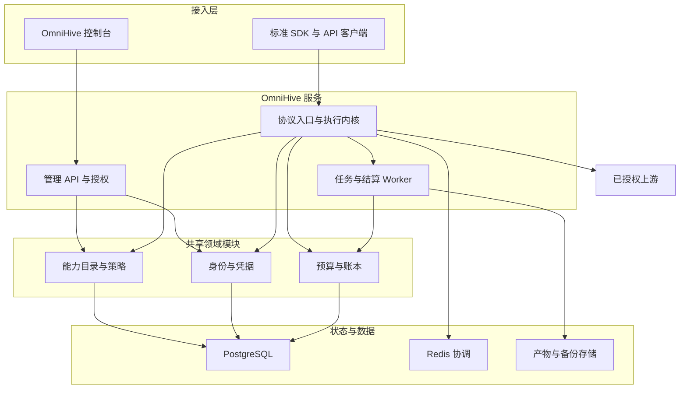
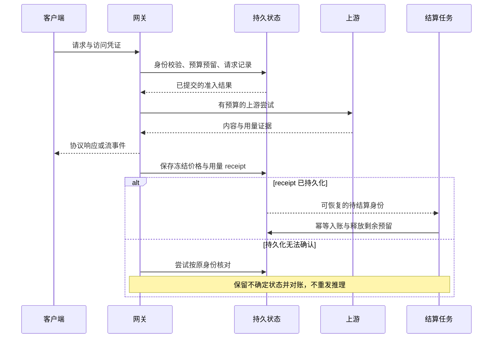

# OmniHive AI 中转站全面重构与独立化升级规划

> 版本：v1.0 · 规划基准日：2026-11-19（Asia/Shanghai）  
> 产品与代码唯一主线：`guanwenpeng2001-bot/OMNIHIVE-AI-GW`  
> 目标：完成 OmniHive 前后端、网关核心、产品功能、服务治理、UI/UX、交付运维的整体升级，并与 sub2api 的产品命名、模块身份和维护发布体系分离。  
> 本文是实施规划。现状结论来自固定源码快照与重点文件核查；目标架构、工期、指标和新增能力均为规划建议，尚未在生产环境验证。

## 阅读导航

1. [执行决策与项目边界](#1-执行决策与项目边界)
2. [源码基线与现状诊断](#2-源码基线与现状诊断)
3. [三个参考项目与两个参考站点的吸收原则](#3-三个参考项目与两个参考站点的吸收原则)
4. [功能差距与整体升级清单](#4-功能差距与整体升级清单)
5. [OmniHive 独立化专项](#5-omnihive-独立化专项)
6. [产品定位、角色与领域模型](#6-产品定位角色与领域模型)
7. [后端目标架构与模块拆分](#7-后端目标架构与模块拆分)
8. [协议、模型、路由与凭据能力升级](#8-协议模型路由与凭据能力升级)
9. [计量、预算、结算与支付升级](#9-计量预算结算与支付升级)
10. [前端 UI/UX 整体重设计](#10-前端-uiux-整体重设计)
11. [前端工程与设计系统实施](#11-前端工程与设计系统实施)
12. [数据迁移、兼容与切流](#12-数据迁移兼容与切流)
13. [安全、可靠性与运维升级](#13-安全可靠性与运维升级)
14. [测试、质量与验收指标](#14-测试质量与验收指标)
15. [分阶段路线、资源与任务拆解](#15-分阶段路线资源与任务拆解)
16. [持续保持前沿的演进机制](#16-持续保持前沿的演进机制)
17. [风险、待确认事项与最终验收](#17-风险待确认事项与最终验收)
18. [证据来源](#18-证据来源)

---

## 1. 执行决策与项目边界

### 1.1 本次升级的最终形态

将 OmniHive 建设为面向开发者、团队和平台运营者的 **多供应商 AI API 中转与治理平台**，形成五项可交付成果：

| 成果 | 完成后的用户价值 | 实施判断 |
| --- | --- | --- |
| 独立的 OmniHive 产品与发行体系 | 从自有仓库安装、构建、升级、回滚，不再依赖 sub2api 主线 | 必须完成，属于发布前置条件 |
| 可维护的网关内核 | 新供应商、新协议和新模型可以按契约接入，问题可定位 | 保留已有有效实现，重新划分责任和接口 |
| 更完整的功能与服务 | 补齐 API 调试、路由解释、任务中心、费用核对等中转站闭环 | 从参考项目吸收已验证设计，并自主实现适合 OmniHive 的增量 |
| 全新的前端体验 | 开发者快速接入，运营快速配置，管理员快速排障 | 重做信息架构、页面流程、组件规范和状态反馈 |
| 可持续升级的工程体系 | 能持续吸收协议、模型、依赖和安全更新 | 自有适配器、能力目录、测试矩阵、版本和发布机制 |

**核心路线：独立化打底 → 内核模块化 → 功能增量与 UI/UX 并行升级 → 数据迁移和灰度 → 持续迭代。**

“重构”不能只交付目录调整或品牌替换；“升级”也不能只堆菜单和接入更多供应商。每一项增量都必须同时说明用户任务、后端能力、数据边界、界面流程、测试与上线方式。

### 1.2 已确定的方向

**范围修订已纳入：OmniHive 定位为 AI API 中转站，不实现 Magpie 的 Agent 接入、发现、客户端配置管理、Connector 或多 Agent 方案功能。** 参考 Magpie 仅限网关协议、调度、配额和路由可解释性。

- **仓库所有权**：以现有 OmniHive 仓库作为唯一事实来源，不更换为另一个参考项目的 fork，不以定期合并 sub2api 作为维护方式。
- **后端路线**：保留 Go 与现有 PostgreSQL、Redis 基础，先做模块化单体；为网关、管理 API、后台任务提供清晰的运行边界。
- **前端路线**：推荐保留 Vue 3 + TypeScript，全面重建领域组织、组件系统和交互。技术独立不要求更换编程语言或 UI 框架。
- **参考项目路线**：吸收 Magpie 的网关协议处理和路由表达、sub2api 的账号与容量管理经验、New API 的协议及运营模块组织；具体代码引入必须单独评估来源、许可和维护成本。
- **功能路线**：已有功能先建立保留清单；参考项目中有价值的差距进入产品待办；只在参考项目里“存在”不是进入主版本的充分理由。
- **兼容路线**：标准推理 API 保持兼容；配置、会话、数据、插件和部署身份采用明确迁移，不进行全仓无差别字符串替换。

### 1.3 “与 sub2api 分离”的准确验收含义

最终版能够仅依靠 OmniHive 自有代码、发布资产、配置和适配器运行；构建不把 sub2api 当业务依赖，升级不回到其发布源，前端与用户文档不再呈现其产品身份。旧格式迁移只存在于限时迁移工具或归档说明中。

已有第三方代码的版权、许可及来源记录需要依法保留。**独立维护、独立品牌和独立架构，不等于可以删除历史代码的来源义务。** 如果未来目标进一步变为“完全不含任何继承实现”，需另立逐模块独立重写与来源审查项目，不能通过改名宣称已经完成。

---

## 2. 源码基线与现状诊断

### 2.1 固定研究快照

| 项目 | 研究分支与提交 | 在本规划中的角色 |
| --- | --- | --- |
| OmniHive | `main` · `513619a2749f5848032475b618798405ae8b4474` | 唯一实施基线 |
| Magpie | `main` · `1e2287758c6d25ed1c3435bf39f8552e225be99b` | 仅作网关协议、调度与路由体验参考 |
| sub2api | `main` · `2af3f1e15c98c893a89255a037f551046883b8c0` | 账号、订阅、容量与存量实现对照 |
| New API | `main` · `3a407cc9b064fe79a4ffac4146b2690c465dc929` | 协议、运营模块、任务及前端组织参考 |

用户最初粘连的链接按 `Wei-Shaw/sub2api`、`QuantumNous/new-api` 两个仓库分别研究。本文不以 star 数、README 营销描述或未经运行的性能数据判断优劣。

核查覆盖仓库目录、依赖、许可证、协议入口、调度与结算关键实现、前端路由及大型页面、安装发布与插件身份。没有运行四个完整应用，没有访问生产数据库、调用真实供应商或执行支付，也没有进行浏览器视觉与可用性实测。

补充站点研究核对了 OpenRouter 模型目录与 OpenCode 官网的公开页面结构、官方服务文档及 OpenCode 部分公开源码；未进入登录后的控制台，未完成端到端交互或可访问性审计。动态页面不固定引用实时模型数、价格或可用率。

### 2.2 OmniHive 已有的基础必须保留

| 已核实基础 | 证据与判断 | 重构处理 |
| --- | --- | --- |
| Go + Gin + Ent，Vue + TypeScript + Pinia + Vite | 依赖文件直接体现；Go module 仍为旧项目路径；前端包名已是 `omnihive-frontend`。[O2][O3] | 保留可用底层，迁移模块身份，统一构建契约 |
| 多协议与多模态入口 | 路由和协议矩阵已有 Chat、Responses、Messages、Gemini、图像及部分音视频能力，实际可用性受平台、账号和模型门槛控制。[O4][O5] | 建立可测试的端点能力合同，避免丢失现有边界 |
| 工作空间隔离 | 有 Workspace、成员授权、资源归属校验及 Ent workspace mixin。[O6][O7][O8] | 完善所有访问路径与新项目层，不能当作“从零新增多租户” |
| 请求生命周期与版本快照 | `GatewayRequestPlan` 已承担模型/价格快照、预算、租约、attempt 和结算状态关联。[O9] | 抽出请求执行模块，统一各协议使用方式 |
| 持久结算凭据与恢复 | `UsageSettlementService` 先保存 receipt，再排队或同步回退；恢复不重新调用模型，也不重新定价。[O10] | 保留并加强，不能退化成仅依赖内存队列 |
| 模型能力目录 | 已有 Model Registry；平台文档区分静态声明、发现结果、账号资格与实际可执行能力。[O5][O11] | 升级目录治理、前端展示和持续验证 |
| 前端导航与主题基础 | 已有个人/管理分区、搜索、折叠、移动端处理、暗色、OmniHive 主题 token。[O12][O13] | 保留能力，重整任务结构与组件一致性 |
| 自有更新源与镜像 | 更新器、安装脚本默认仓库及 Compose 镜像已指向自有仓库。[O18][O19][O20] | 继续完成发行资产和运行身份统一，不能误写为仍默认从上游更新 |

仓库已有多类单元、契约、集成和安全相关测试文件。规划重点是验证质量及补齐迁移风险，不把“没有测试”作为未经证实的诊断。

### 2.3 本次直接发现的重构重点

| 编号 | 源码事实 | 含义与优先级 |
| --- | --- | --- |
| D01 | `backend/go.mod` 为 `github.com/Wei-Shaw/sub2api`，大量本地 import 沿用该路径。[O2] | 模块所有权与产品身份未统一，P0；这本身不证明运行时下载上游 |
| D02 | `CreateAccountModal.vue` 约 7,000 行，`GroupsView.vue` 约 5,400 行。[O14][O15] | 供应商条件、授权、价格和路由编排集中，需拆分；行数本身不等于已证实的体验故障 |
| D03 | `openai_gateway_handler.go` 约 4,400 行，调度和计费服务也很大。[O16][O17] | 按协议、请求执行、策略、资金职责拆分，先建立行为回归保护 |
| D04 | 核心计费模型仍可见大量 `float64` 金额/价格字段。[O17] | 新 Money 类型与舍入规则需要贯穿链路，迁移先做差异核对，不宣称已有错账 |
| D05 | 结算服务明确说明：恢复保障从首次 receipt 成功落盘之后开始。[O10] | 首次凭据前的进程/数据库故障仍须标记不确定并对账，不承诺端到端严格 exactly-once |
| D06 | 自有更新源与旧二进制/目录名称并存；GoReleaser 归档名与安装脚本预期有静态差异。[O18][O19][O21] | 独立发行合同需要端到端修复；实际线上资产是否受影响尚待验证，P0 |
| D07 | 插件仍有 `.s2plugin`、旧 manifest 字段、protobuf package 和握手标识，签名绑定 manifest 原始字节。[O22][O23][O24] | 必须版本化迁移并重新签名，P0/P1；不能机械替换后沿用旧签名 |
| D08 | 前端仍有 `Sub2API` 站点名 fallback、无产品命名空间的会话键及旧刷新锁名。[O25][O26][O27] | 统一品牌与会话层，同时处理新旧标签页并发，P0 |

---

## 3. 三个参考项目与两个参考站点的吸收原则

### 3.1 项目定位与取舍

| 参考项目 | 本次核实的特点 | 值得吸收 | 需重新设计的边界 |
| --- | --- | --- | --- |
| Magpie | 本地多 Agent 配置与网关，Go/Wails，Web 界面使用原生 HTML/CSS/JS；MIT。[M1][M2][M3][M7] | 协议中间表示、候选排序接口、真实路由 trace、渐进配置 | 本机凭据发现不适合作为服务端默认行为；可丢弃的观测队列不能承担账务；权限与资金不能统一 fail-open。[M8] |
| sub2api | Go/Gin/Ent + Vue，订阅/API 账号池、粘性、并发租约、限额、幂等扣费。[S1][S2][S3] | 账号生命周期、配额窗口、并发控制和异常状态表达；对照已有同类功能补齐行为 | 大量能力已在 OmniHive 中存在，不再整块合并；订阅凭据与官方 API Key 分别建模 |
| New API | Go 网关与运营系统；当前前端已为 React 19/TypeScript/Rsbuild/TanStack/Tailwind 4；存在 RelayKit 与插件模块。[N1][N2][N3] | 协议转换质量分级、运营功能组织、共享数据表格、调试/任务体验、逻辑请求与尝试指标分离。[N8][N9] | Group 不等于租户；不能因为独立 Go 子模块就当作宽松许可库；巨型编辑页面不照搬 |

New API 根许可证为 AGPLv3，NOTICE 包含界面归属等附加说明；sub2api 根许可证为 LGPLv3，其 README 另有需澄清的许可表述；OmniHive 根 LICENSE 当前也是 LGPLv3。这里记录的是仓库材料，具体复用方案必须按实际继承/引用内容评估，不能简单把整个 OmniHive 改成另一个许可证。[O28][S1][S4][N4][N10]

### 3.2 功能吸收的统一评审模板

每个候选功能填写：**用户问题 → 参考实现及证据 → OmniHive 当前覆盖 → 自有设计 → 依赖与数据影响 → 许可判断 → 验收 → 发布阶段**。

允许三种吸收方式：设计思想自主实现；在已有模块上补齐差距；经过明确评审的有限代码复用。默认采用前两种，避免重新形成对参考项目的运行、发布或持续合并依赖。

### 3.3 OpenRouter 与 OpenCode：同时借鉴产品体验和公开服务契约

补充参考读取日期为 2026-11-19。OpenRouter 以官方公开页面、API 与机制文档为证据；OpenCode 另核实官方 `anomalyco/opencode` 仓库，固定源码快照为 `910c423e48891fcc147e843d9c5c11cf892a5a38`。**公开行为可作为产品需求，公开源码可作为实现参考，未公开的后端架构不作推断。**

| 参考 | 已核实的优势与证据 | OmniHive 的采用方式 | 明确边界 |
| --- | --- | --- | --- |
| OpenRouter 模型发现 | 模型目录、端点与价格/能力筛选；公开 Chat 支持多模型并排比较。[R1][R2][R13] | 升级现有模型广场与比较器；在模型详情关联实际可调用端点、协议、费用与 Playground | 模型级最大能力不代表每个端点都支持；不照搬浮动模型数或性能宣传 |
| OpenRouter 路由 | 供应商排序、候选限制、回退和最高价格等公开机制。[R3] | 将现有调度能力产品化，区分硬限制与软偏好，提供版本化策略、解释与模拟 | 延迟/吞吐偏好不能承诺为硬 SLA；请求覆盖只能收紧强制政策 |
| OpenRouter BYOK 与成本 | 自带凭据的范围、优先/备用与平台容量回退；Key 预算、请求详情和 Activity 分析。[R6][R7][R8][R9] | 在已有凭据和账务上补齐租户 BYOK；统一成本筛选和请求下钻 | 管理员上游凭据不等于租户 BYOK；不得静默把外部用量转换为平台余额消费 |
| OpenRouter 隐私和观测 | 路由数据策略、区域、外部观测导出均有独立约定。[R3][R4][R5][R10] | 建立可验证的端点事实、空间有效策略和异步观测导出 | 不训练、安全留存、严格零留存、推理地域、账务元数据与日志目的地分别表达 |
| OpenCode 模型服务与 Console | 模型/API 文档、预算、账单和订阅将能力与费用解释放在接入流程中。[C2][C3][C4][C5][C6][C7][C8] | 形成自助接入、有效预算解释、费用来源与最终结算状态的完整体验 | 编程客户端、Console 模型服务和 Go 订阅是不同产品边界；不把 Go 默认视为通用转售上游 |
| OpenCode 官网与设计治理 | 公开设计规范集中定义 tokens、共用组件、布局稳定、复制反馈、移动交互及键盘行为。[C11][C12] | 为 OmniHive 制定 Vue 组件规范与页面验收样例，官网、文档、控制台共用品牌和交互基础 | 保留 OmniHive 自主视觉；设计规范存在不等于全站通过可访问性测试 |

OpenCode 的[旧 Zen 文档](https://opencode.ai/docs/zen/)本次已重定向至 Console models，公开设计规范也使用 OpenCode Models 名称；本方案按当前模型服务与控制台参考，不沿用旧品牌来界定整个产品。[C3][C11] OpenCode Console 公共介绍含示例目录/工作区，不能把这些示意数据当成真实生产性能。[C10]

采用顺序：**先整理 OmniHive 已有能力 → 明确真实缺口 → 设计自有领域合同 → 落实页面与工程实现 → 用真实链路验收**。五个参考输入不产生五套架构，也不要求将 Vue 改为参考站点所用框架。OpenCode 根许可证为 MIT，有限源码复用仍需保留适用声明。[C13]

## 4. 功能差距与整体升级清单

### 4.1 现状标记与优先级

现状使用四种表述：**已有**＝源码证实基础能力；**部分**＝基础存在但完整闭环或统一覆盖不足；**待核实**＝抽样未发现等价入口，开发前必须继续确认；**明确需升级**＝源码直接表明当前实现边界。没有运行验证的功能不标为“生产已验证”。

优先级：**P0** 为独立发行、安全与一致性门槛；**P1** 为本轮核心产品升级；**P2** 为后续生态和规模增强。P2 不应挤占 P0/P1 的测试、迁移与可用性验收。

### 4.2 参考项目到 OmniHive 的增量矩阵

| ID | 升级内容与参考来源 | OmniHive 当前状态 | 本次新增或增强的具体内容 | 优先级与验收 |
| --- | --- | --- | --- | --- |
| F01 | 通用开发者 Playground；参考 New API | **待核实**统一入口；已有管理员 AccountTestModal 和模型广场。[O31][O32][N5] | 面向用户授权范围提供多协议文本调试、流式停止、工具调用事件、请求/响应、模型对比与费用明细 | P1；不暴露上游凭据，停止/重试语义正确，计费可追溯 |
| F02 | 可解释路由；参考 Magpie 实时 trace | **部分**：已有 request attempts、调度 decision 和 Ops 详情。[O9][O33][O34][M4] | 展示候选排除原因、排序因素、亲和命中、限额、每次尝试和最终选择 | P1；解释完全来自服务端，前端不推测选择原因 |
| F03 | 无副作用路由模拟器；OmniHive 自主增量 | **待核实**与生产内核共用的模拟 API/UI | 基于只读快照比较新旧策略，验证预算/区域/协议限制，显示预期命中与不确定性 | P1；不读取明文凭据、不占额度、不调用付费推理；不是把影子账号当影子流量 |
| F04 | 跨供应商成本、延迟、配额策略；参考 Magpie/sub2api | **已有重要基础**：OpenAI 调度已有 TTFT/error、cost、reset、quota headroom 及设置页。[O33][O35] | 跨供应商统一数据口径；提供稳定、低延迟、低成本、窗口均衡等模板，保留硬性权限与质量约束 | P1；配置能影响真实选路，未知配额不作为无限额，策略可模拟和回滚 |
| F05 | 模型广场与比较增强；参考 New API 指标组织 | **已有**收藏、排序、最多三模型比较、价格与能力标签、SDK 示例。[O32][O36] | 加入带样本量和时间窗的成功率、TTFT/生成速度；按输入/输出/缓存场景估算费用 | P1；估算可复算，价格、授权、能力、性能来源分别呈现 |
| F06 | 统一任务中心；参考 New API TaskAdaptor | **部分**：已有批量生图、异步恢复/结算和多媒体入口。[O1][O37][N3] | 统一任务 ID、状态、产物、重试/取消与费用；首期整合图像，再扩到已验证的音视频适配器 | P1 图像；P2 跨类型；取消不支持时说明，未知进度不伪造百分比 |
| F07 | 协议转换质量与诊断；参考 Magpie IR、New API RelayKit | **部分**：已有 native/bridge/rejected 能力及桥接测试。[O5][O11][M5][N6] | 转换计划、字段损失提示、能力降级策略、工具/reasoning/usage 流式诊断 | P0 合同；P1 界面；不支持的能力提前拒绝，不静默丢字段 |
| F08 | 更细的资源/动作权限；参考 New API 权限目录 | **部分**：workspace/资源隔离已存在，成员目前主要为 member/admin。[O6][O39][N7] | 运维只读、账务、凭据管理、策略发布、日志导出/重放等独立权限；支持项目作用域 | P0 权限合同；P1 配置 UI；直接 API、缓存与异步任务同样受控 |
| F09 | 供应商向导与配置系统；综合参考 | **已有向导基础但体量大**，并非首次增加步骤。[O14] | 版本化 ProviderSchema、受控组件注册、五步接入、批量变更预览、保持/设置/清空语义 | P1；新增同类供应商无需持续扩张主表单条件分支 |
| F10 | 运营诊断与容量解释；参考三项目 | **已有**Ops、错误分类和耗时/TTFT 分位数；账号可用不等于任意模型请求可服务。[O40][O41] | 打通请求、attempt、策略、凭据状态、价格版本和结算；按 workspace/model 解释可用性 | P1；一次逻辑请求不被重试放大计数，排障路径可从告警直达详情 |
| F11 | 凭据与订阅生命周期工作台；参考 sub2api | **已有**刷新、到期、限额、模型级冷却、Passkey 等基础。[O42][O47][S7] | 将授权、测试、启用、轮换、耗尽、恢复、撤销串成时间线；保留上次成功读数与来源 | P1；未知状态不显示为零，轮换不破坏在途请求和审计 |
| F12 | 恢复任务可靠性；参考 sub2api 的任务所有权 | **已有**备份恢复；当前所查结构缺少显式持久操作代次，需要全链复核。[O43][S8] | RestoreJob/operation_id、条件更新、进度、恢复前快照和隔离演练，防止旧任务回写覆盖新任务 | P0；故障/重启/重复启动场景不会误报成功或覆盖较新状态 |
| F13 | OmniHive 插件 SDK 与能力扩展；参考两项目 | **已有**签名包、独立进程/gRPC、UI Bridge；公开契约主要是 OpenAI OAuth outbound transport。[O44] | 先完成自有 v2 协议与迁移，再按需要增加 provider/task 能力；宿主统一管权限、网络、计量 | P1 身份/SDK；P2 通用能力；不默认开放任意脚本执行 |
| F14 | 持续能力验证与生态目录；OmniHive 自主增强 | **已有**Registry 和契约基础 | 供应商变化收集、证据更新时间、兼容样例、实验/稳定分级、废弃通知与适配器健康看板 | P1 基础流程；P2 自动化；目录更新不能自动授予权限或改变价格 |
| F15 | 租户 BYOK 与费用来源；参考 OpenRouter/OpenCode | **待核实完整闭环**：已有管理员上游凭据管理，不能据此认定具备租户产品。[R6][C8] | 空间级凭据托管、模型/成员/Key 授权、优先与备用、可控共享容量回退；分列外部估算和平台收费 | P1 契约/受控试点；P2 完整服务；跨空间不可使用，不允许静默产生额外平台消费 |
| F16 | 有效隐私与地域策略；参考 OpenRouter | **部分**：已有策略字段；Workspaces 页明确当前路由偏好为账户级。[O46] | 平台→空间→项目→Key→请求约束合成、来源解释、严格留存与地域资格验证 | P0 作用域核查；P1 执行与 UI；无合格端点时明确拒绝，不能静默越界 |
| F17 | 官网、文档、价格与状态闭环；参考两个站点 | **已有部分入口**，需逐页盘点内容和事实来源。[O1][O31] | 自有首页、模型详情、透明定价、接入文档、更新记录、服务状态；共享目录与定价投影 | P1；公开信息与控制台一致，示例可验证，未知状态不能伪装健康 |

### 4.3 优先形成的三个完整产品闭环

**开发者闭环**：发现模型 → 了解能力/价格 → 生成受限 Key → 标准 API 调用或 Playground → 查看请求 → 核对费用 → 定位问题。

**运营闭环**：连接上游 → 验证授权/模型 → 配置资源池 → 模拟策略 → 发布版本 → 观察容量与错误 → 轮换/恢复 → 审计。

**平台闭环**：定义角色/预算 → 执行网关策略 → 持久计量与结算 → 对账 → 告警/恢复 → 发布与回滚。

本轮主版本应完整交付 P1 闭环。视频、音频、完整 BYOK 和通用插件等 P2 以接口与数据模型预留，并按后续版本逐项交付；已有相关功能仍按保留清单迁移，不以 P2 为理由删除。

### 4.4 已有功能保留与现代化清单

现有用户/管理员、模型广场、模型比较、Keys、用量、账号/代理/资源池、组合分组、订阅、订单/支付、兑换/推广、批量生图、监控、审计、备份、身份登录与 Passkey、传输插件、面板更新等都应进入“旧功能 → 新模块 → 新页面 → 验收用例”台账。若某功能调整或退场，必须给出使用情况、替代路径、数据处理和告知方案，不能在 UI 重做时静默消失。[O1][O31]

## 5. OmniHive 独立化专项

### 5.1 统一产品身份与命名合同

推荐显示名称统一为 **OmniHive**，仓库继续使用现有 `OMNIHIVE-AI-GW`；无需为了改名搬迁仓库或重写 Git 历史。

| 层级 | 当前证据/状态 | 目标 | 迁移要点 |
| --- | --- | --- | --- |
| Go module | 旧 module 及内部 import | `github.com/guanwenpeng2001-bot/OMNIHIVE-AI-GW/backend` | 保留 backend 为模块根；一并修改手写导入、生成器配置和自有 SDK |
| 前端包 | 已是 `omnihive-frontend` | 保持自有身份，必要时组织为 `@omnihive/*` 私有包 | 不虚构 sub2api npm 依赖；检查 lockfile、构建产物与 sourcemap |
| 构建产物 | 部分输出 `sub2api`，开发构建另有 `bin/server` | 主服务 `omnihive`，辅助 CLI `omnihivectl` | Makefile、Docker、GoReleaser、entrypoint 使用同一 manifest |
| 容器镜像 | 自有 GHCR 已具备 | 保持自有镜像地址，正式部署固定 tag/digest | 统一 OCI 标签、源码 URL、SBOM 和版本元数据 |
| 系统服务与用户 | `sub2api.service`、旧用户名等 | `omnihive.service`、`omnihive` | 对已有卷保留数字 UID/GID 的访问能力；不能只改名称后丢权限 |
| 安装目录 | `/opt/sub2api`、`/etc/sub2api` | `/opt/omnihive`、`/etc/omnihive`，独立数据目录 | 迁移工具检测、校验、备份、复制并切换；禁止直接删旧目录 |
| Compose 资源 | service/container/network/volume 有旧名 | 新安装全部 `omnihive_*` 体系 | 存量卷明确绑定旧物理卷，或完整复制后切换，防止自动创建空卷 |
| 配置与环境变量 | 通用键与旧项目专属键混合 | 版本化 `config.yaml`，新增专属键使用 `OMNIHIVE_*` | `DATABASE_*` 等通用键无需仅为改名全部破坏；旧专属键只在迁移工具解析 |
| 页面与内容 | 部分 title、fallback、引导/插件字段残留 | 标题、帮助、错误、邮件、示例、图标、下载都统一 OmniHive | 统一 BrandConfig；用户自定义站点名不强制覆盖 |
| 浏览器状态 | 主题已有 `omnihive.*`，认证键及锁未统一 | 统一会话管理；非敏感偏好采用 `omnihive.<域>.v<版本>` | 认证采用安全迁移流程；不能仅重命名 localStorage 就认为安全已升级 |
| 插件接口 | `.s2plugin`、v1 旧命名 | 建议 `.ohplugin`、manifest v2、`omnihive.plugin.v2` | 旧包先验签，转译生成新包后重新签名；新 SDK 与信任根自主管理 |
| 可观测与文档 | 需检查日志/指标/资源标识 | `service.name=omnihive-*`、自有文档与告警 | 仪表盘和告警规则同步迁移，旧指标别名设退出时间 |

### 5.2 Go 模块与前后端依赖分离步骤

1. 固定基线 tag，形成依赖、许可证、生成代码和构建入口清单。
2. 修改 Go module 路径；使用语法感知工具调整本地 import、测试和工具入口，检查 `replace`、workspace、生成器及 protobuf `go_package`。
3. 重新生成 Ent、Wire、protobuf 等受影响产物，审查差异；不得改写已执行数据库迁移文件及其 checksum。
4. 执行依赖图与构建检查，确认不存在指向 sub2api 的业务模块依赖、Git submodule、构建下载或更新回退。
5. 前端统一 BrandConfig、API client、session、feature flags、SDK 类型和文档；按领域替换巨型页面。
6. 在清洁环境用自有仓库、自有制品完整构建、启动、升级和回滚；将可复现步骤纳入 CI。

最终禁止项应按类型检查：Go import/依赖图、实际网络目的地、发布 manifest、前端可见文本和构建产物。仅用 `rg sub2api` 的零匹配不能证明独立；许可证与明确归档的来源记录应设允许列表。

### 5.3 发行与更新器专项

现有默认更新仓库已正确指向 OmniHive，接下来要统一 **资产命名、产品身份、版本兼容、签名验证与回滚记录**。[O18][O19][O21]

- 建立唯一 Release Manifest：`product_id`、应用版本、commit、平台/架构、资产名、SHA-256、签名、允许的数据库版本区间、最低升级版本。
- 新命名建议 `omnihive_<version>_<os>_<arch>.tar.gz`；以 manifest 为准，不让安装器、面板更新器、CI 各自拼接不同文件名。
- 默认只接受自有正式发布；自定义镜像/企业分发源需要显式配置和相同的产品身份/签名验证，不提供静默切回其他项目的逻辑。
- 安装、面板更新、容器更新和回滚走同一套版本兼容判断。二进制回滚不能等同数据库回滚。
- 生产容器推荐由部署系统替换固定镜像；如继续支持容器内面板更新，必须明确适用部署模式、持久路径和恢复契约。
- 发布前运行真实资产契约测试：生成制品 → 安装器取包 → 启动 → 旧数据升级 → 允许版本回退。静态配置矛盾在该测试通过前不能关闭。
- 覆盖 full/simple GoReleaser、GHCR/其他镜像发布支路、通知中的包链接，不遗漏旁路发行配置。存量 `.updates/current/sub2api` 可能被 entrypoint 在重启时恢复为运行文件，升级前必须校验、迁移或封存，防止旧暂存制品覆盖新镜像。[O48][O49][O50]

### 5.4 认证、数据和插件不能直接全局改名

**认证**：保留持久 JWT/TOTP/数据加密密钥、API Key 数据和 Passkey 的 RP ID 关系。旧前端与新前端使用不同 refresh lock 名可能同时刷新令牌；用过渡客户端、统一会话协议或一次性版本切换解决，并测试多标签页、回退和撤销。会话迁移失败时可要求重新登录，但不能导致账号、余额或凭据丢失。[O26][O27]

**数据**：数据库名字、连接用户、卷名与表内容分别处理。新安装用 OmniHive 命名；存量实例先保持物理数据连接，再按明确步骤迁移。Redis 缓存、并发租约、幂等键、队列和会话不能作为同一种“可删缓存”统一清空。

灰度期间新旧实例不得分别使用互不相识的预算、限流和刷新锁前缀，否则会发生重复执行或额度放大；先共用受控协调层，待旧实例排空后再迁移。配置还需统一 `DATA_DIR` 与更新器使用的 `OMNIHIVE_DATA_DIR` 的优先级，提供实际生效路径诊断。迁移前确认 TOTP 加密密钥已经持久化，不能沿用“未配置时临时生成”来处理已有加密数据。[O45]

**插件**：原包签名覆盖原始 manifest。转换流程是“验证旧包 → 检查能力和发布者 → 生成新格式 → 使用受控发布者重新签名 → 测试 → 替换”。没有签名权限或不兼容的第三方插件，应等待其发布者提供新版，不能伪造可信身份。旧格式导入工具独立打包、限定期限，最终发行版不继续暴露旧协议。[O22][O23][O24]

旧 `requires.sub2api` 版本范围不能直接解释为 OmniHive 版本；需要显式宿主兼容映射。protobuf package 与握手改变后应重新生成 SDK、重建插件。内置信任根的私钥所有权必须核实，不能只改 key ID 就宣称签名体系已独立。

信任根迁移必须说明“存量验证器为何信任新根”：通过已有可信发布链交付受签名的信任元数据；若旧链或私钥所有权无法证明，则采用明确的运维引导流程核验新发行者与固定摘要，禁止自动接受下载包自带的任意公钥。记录旧包摘要/签名者与新包摘要/签名者的映射。迁移包验证成功只证明来源，不自动授予新版额外能力；新增网络、文件或执行权限独立评估。

### 5.5 独立化完成标准

- [ ] 从自有仓库干净检出可完整构建，前后端不需要 sub2api 仓库可用。
- [ ] 标准发行包、镜像、服务、命令、页面、SDK 和文档全部使用 OmniHive 身份。
- [ ] 安装、检查更新、升级、回滚的测试均指向自有资产，错误产品制品被拒绝。
- [ ] 旧数据迁移后用户、凭据、API Key、余额、订单、任务、订阅和审计记录可核对。
- [ ] 旧插件与认证迁移有明确结果和退出时间，无静默丢失。
- [ ] 保留必要的第三方许可/归属，源码历史可追溯；新业务开发不依赖上游同步。

## 6. 产品定位、角色与领域模型

### 6.1 角色与任务边界

| 角色 | 高频任务 | 默认首页 | 关键权限边界 |
| --- | --- | --- | --- |
| 开发者 | 找模型、创建 Key、调用 API、调试、查请求 | 项目概览与接入进度 | 仅访问被授权项目、模型、日志和预算 |
| 工作空间管理员 | 成员、项目、预算、资源分配与策略 | 空间概览与待处理项 | 不自动取得全平台权限或全部上游凭据 |
| 运营/运维 | 上游接入、容量、策略、健康、故障处理 | 运行中心 | 查看/修改/发布/轮换分别授权 |
| 财务/审计 | 费用核对、账单、调整记录、审计导出 | 费用与结算 | 不因查看费用获得提示词或凭据访问权 |
| 平台管理员 | 身份、全局策略、发布、备份、系统配置 | 平台健康与风险待办 | 高风险操作有再次验证、影响预览和审计 |

### 6.2 统一术语，拆开重叠概念

| 术语 | 目标定义 | 与现有对象的关系 |
| --- | --- | --- |
| Workspace 工作空间 | 权限、数据与资源归属边界 | 沿用已有 workspace；完善遗漏链路 |
| Project 项目 | 同空间下的应用/成本与策略归集单元 | 本轮新增或逐步引入；为旧资源创建默认项目映射 |
| Provider 供应商 | 供应商身份与适配能力 | 来自现有平台注册表，不保存客户密钥 |
| Connection 上游连接 | 供应商、区域、endpoint、网络策略、协议配置 | 从 Account 的连接配置中逻辑拆出 |
| Credential 上游凭据 | 受控 secret reference、类型、版本、轮换状态 | 复用已有 secret 基础，避免配置 JSON 散落秘密 |
| Pool 资源池 | 可调度连接/凭据集合及容量约束 | 承接现有 account/group 的资源组织职责 |
| RoutePolicy 路由策略 | 过滤、优先级、权重、回退及亲和规则 | 从混合分组配置中拆出，版本化发布 |
| ModelAccessPolicy 模型访问策略 | 用户/项目能用哪些模型和动作 | 与模型目录和上游实际授权分离 |
| PricePlan / Entitlement | 销售价、套餐和可使用权益 | 承接现有定价、订阅；不与资源池实体混在一起 |
| API Key 访问密钥 | 下游调用 OmniHive 的凭证 | 与上游 Credential 使用不同 UI 和权限 |
| Request / Attempt / Job | 逻辑请求、一次上游尝试、异步作业 | 分别计数、跟踪、结算，不能一张表混用语义 |

现有 Group/Composite Group 往往承担多种职责，应先做字段到领域的映射，再逐步拆数据。不能把一个 group 简单重命名为 workspace；也不能要求所有旧 group 一对一映射为新 pool。

现有 Workspaces 页面中部分路由偏好实际是账户级设置，源码提示切换 workspace 不改变该设置。因此“工作空间级策略”需要核查真实执行作用域，并在本轮明确落入空间/项目策略版本，不能只修改页面标签。[O46]

### 6.3 核心数据设计

建议逻辑实体包括 `workspaces`、`workspace_members`、`projects`、`api_keys`、`provider_connections`、`credential_versions`、`pools`、`pool_members`、`route_policy_versions`、`model_capabilities`、`request_attempts`、`budget_reservations`、`usage_receipts`、`ledger_entries`、`jobs`、`audit_events`。

这是目标领域模型，**不是要求无条件新建同名表**。已有 Ent schema、secret、receipt、任务和审计表先评估复用，通过应用层接口隐藏旧结构，降低一次性迁移面。

基本约束：所有租户资源有 workspace 归属；项目必须属于同一空间；跨资源引用校验归属；全局管理员的跨空间操作使用显式作用域并记录审计；唯一约束纳入作用域；查询、导出、缓存、异步队列和对象存储路径都遵循同样边界。

## 7. 后端目标架构与模块拆分

### 7.1 先模块化，再按实际负载拆进程

首阶段使用一个代码库与 Go 模块，按职责提供 `all`、`gateway`、`control`、`worker` 等运行模式。小规模部署可单进程，较大规模按模式拆部署；领域模块的接口保持相同。这样既保留单体调试和事务能力，也为独立扩容准备边界。

图中的调用关系是逻辑边界。拆进程时用已持久化的 outbox/作业记录交接，不能用进程内 channel 代替跨进程可靠队列。管理面短时不可用不应立即使已发布策略失效；网关读取已验证快照，并明确其最大允许陈旧时间与撤权传播规则。

### 7.2 目标模块与责任

| 模块 | 职责 | 不应承担的职责 |
| --- | --- | --- |
| identity / access | 用户、登录、Key、workspace/project、资源动作授权 | 供应商错误重试、费用计算 |
| catalog | 模型/平台能力、证据、版本与可见性 | 通过静态列表自动授予上游权限 |
| gateway / execution | 请求生命周期、取消、deadline、attempt、资源释放 | 页面设置编排、支付回调 |
| protocol | 入站/出站 codec、SSE/WS、错误格式和兼容诊断 | 决定哪个客户可调用 |
| providers | 供应商适配器、连接、探测与原生动作 | 修改钱包或绕过宿主策略 |
| credentials | secret 版本、授权刷新、锁、撤销与审计 | 在日志中回显密钥 |
| routing | 候选过滤、评分、亲和、预算内回退、decision trace | 任意修改请求身份和计费事实 |
| metering / billing | 用量证据、价格快照、预留、receipt、账本、对账 | 通过重发推理恢复缺失账务 |
| tasks | 图像/视频等异步任务、重试边界、产物生命周期 | 把所有任务当作幂等 HTTP 请求 |
| payments / subscriptions | 订单、回调验证、权益和退款状态 | 将支付状态直接等同模型调用状态 |
| ops / audit / release | 指标、告警、备份恢复、发布与审计 | 持有隐藏的第二套路由和计费规则 |

依赖方向为 transport/handler → application → domain/port；数据库、Redis、HTTP client、KMS 等在 infrastructure 实现 port。禁止某个 provider 直接写账本，也禁止 UI 专用 DTO 成为跨域业务模型。

### 7.3 建议目录

| 路径 | 内容 |
| --- | --- |
| `backend/cmd/omnihive/` | 主服务与运行模式 |
| `backend/cmd/omnihivectl/` | 诊断、迁移、配置检查；不要求用户安装 Go |
| `backend/internal/modules/<domain>/` | 各领域的应用服务、模型、端口与测试 |
| `backend/internal/gateway/{execution,protocol,routing}/` | 热路径实现与协议契约 |
| `backend/internal/providers/<provider>/` | 供应商适配和专属测试 |
| `backend/internal/platform/` | 数据库、Redis、时钟、密钥、网络、遥测 |
| `backend/api/` | 管理 API、事件与错误契约 |
| `backend/pkg/pluginapi/v2/` | 对外 OmniHive 插件 SDK |
| `frontend/src/{app,shared,features}/` | 应用壳、共享组件、领域模块 |
| `contracts/` | 端点/能力矩阵、golden fixtures、兼容案例 |
| `deploy/`、`docs/adr/`、`docs/migrations/` | 自有发行、决策记录与迁移手册 |

先搬迁最稳定、边界明确的模块，再拆大型 handler/service；每个 PR 保持可构建和可回归。不要同时把“身份改名、协议改写、数据库替换、前端换框架”合成一次上线。

### 7.4 核心接口合同

- **IngressCodec**：解析客户端协议、编码响应和错误；保证原协议的事件与状态含义。
- **CapabilityResolver**：结合目录、账号授权、模型、动作和策略给出有效能力及解释。
- **ProviderAdapter**：执行已获准的上游动作；文本、任务、Realtime 等使用独立能力接口，避免每个供应商被迫实现所有方法。
- **RoutePlanner**：基于只读输入生成候选、拒绝理由和排序；容量预留及实际执行由执行内核完成。
- **CredentialResolver**：在真正调用前解析 secret reference；返回短生命周期凭据，日志只保留安全元数据。
- **UsageSink / SettlementService**：接收带身份和价格版本的持久结算证据；不可把采样遥测当作账单来源。

请求上下文统一携带 `request_id`、`workspace_id`、`project_id`、`api_key_id`、协议/动作、模型标识、策略/价格/能力版本、deadline、attempt budget、trace 标识。敏感凭据不放入通用可序列化上下文。

### 7.5 重复实现审计：优先抽象什么，保留什么

以下不是按名称推测，而是对固定快照中的函数和调用链抽样。每项区分“确认重复”“责任重叠”“已经共享”与“仅生命周期相似”。前端的对应清单见 11.6。

| 编号 / 优先级 | 已发现的具体位置与性质 | 统一方案 | 必须保留的差异与验收 |
| --- | --- | --- | --- |
| B01 / P0 | Responses、Messages、ResponsesWebSocket 各自维护 switchCount、失败账号集、同账号重试数；`failover_loop.go` 已有 FailoverState。[O16][B1] | 基于已有 AttemptBudget，收敛为 AttemptController，统一截止时间、次数、排除集、退避与决策记录 | 不合并所有协议循环；OAuth 窗口、WS turn、已输出语义内容的处理各有合同。同一故障序列得到一致预算结果 |
| B02 / P0 | GatewayHandler 与 OpenAIGatewayHandler 的流式错误收尾责任重叠；Responses failed 编码已有共享函数。[B2][O16] | ResponseLifecycle 统一未提交/仅心跳/语义输出/终态，协议 ErrorEncoder 独立 | JSON、SSE、Responses/Anthropic 事件及 WS close 保留；不得双终止、JSON 拼到 SSE 或在输出内容后重放 |
| B03 / P0 | 普通与 Google API Key 中间件重复编排身份、workspace、状态/IP、分组、配额及订阅判断。[B3][B4] | CredentialAuthenticator + AccessDecision 作为单一政策内核 | 凭据提取优先级、query key 允许条件、用量查询规则与协议错误格式保留；直接 API 和切空间均验证 |
| B04 / P1 | `resolveChannelPricing` 与 `resolveOpenAIChannelPricing` 选择 group/channel 来源的逻辑近同，后者多 nil 保护。[B5][B6] | 合并到现有 ModelPricingResolver，不增加第二个价格服务 | 保留未知价、零价、渠道覆盖、缓存/媒体与阶梯语义；同输入给出同一来源与价格快照 |
| B05 / P1 | `recordUsageCore` 与 OpenAI `RecordUsage` 重复组装部分用量/倍率/日志字段；最终 settlement 和若干计算已共享。[B5][B6][O10] | 适配器产出 UsageEvidence，共同 assembler 生成冻结 receipt | 原生 token、缓存读写、reasoning、部分失败、真实/请求模型及组合渠道归属保留；不新增账本或第二次扣费 |
| B06 / P1 | 上游元数据解析、Registry 合并和公开元数据投影分处多文件，但不是同一算法的重复。[B7][B8][B9] | 共用 Evidence/Capability 字段、单位和快照；保留三个阶段 | 上游事实、人工声明、参考数据与网关支持不可混淆；未知不等于 false，私密来源不能公开 |
| B07 / P1 | UpstreamJob、ImageTask、BatchImageWorker 生命周期相似，职责分别为上游作业、结果存储与队列租约。[B10][O37][B11] | 共用 JobIdentity、Lease、TerminalTransition、RetrySchedule、AuditEvent 原语 | 上游完成、产物存好、批次部分成功和结算完成分别记录；丢租约的旧 Worker 不能覆盖新代次 |
| B08 / P2 | 两个 CaptureRequestPlan 包装方法重复装配，主体 `captureGatewayRequestPlan` 已共享。[O9] | 随相邻改动收敛依赖装配为 RequestPlanFactory；保持薄入口 | 十余行包装不优先于真实风险；HTTP 请求、WS turn、异步 job 不强行共用同一生命周期身份 |

按 **鉴权政策 → 尝试决策 → 响应生命周期 → 价格选择与用量装配 → 元数据字段与任务原语** 逐入口迁移。抽出公共类但旧路径仍各自实现同一政策，不算完成。

### 7.6 防止“重构出更多重复”的工程约束

1. **一个政策有一个权威执行点。** 鉴权、价格选择、结算、能力允许、重试预算各有明确 owner；handler、worker、UI 只能调用或展示。
2. **先抽规则，再抽组件，最后统一编排。** 先保留真实差异，避免一个万能 service/万能表单积累几十个布尔参数。
3. **领域模块通过合同合作。** Provider 不直接写余额，订单不直接改推理状态；跨域必须通过应用服务或可靠事件。
4. **查询投影与业务事实分开。** 页面可组合不同模块的数据，不能为了一个仪表盘再复制一套计价、权限或健康算法。
5. **共享代码必须有真实调用方。** 每个抽象至少解释已存在的调用场景和变化原因；仅预计“将来可能共用”的接口不抢先泛化。
6. **迁移有退出动作。** 记录旧入口、新入口、已切调用方、剩余调用方、删除条件；双路径仅用于有限期验证。
7. **代码行数不是质量目标。** 验收看同类需求修改点是否减少、政策是否一致、协议/账务是否回归通过，以及团队能否独立修改一个模块。

每个抽象 PR 附四项内容：前后责任图、行为对照样例、调用方迁移表、保留差异说明。不会因代码看起来相似就合并不同领域实体或数据库表。

## 8. 协议、模型、路由与凭据能力升级

### 8.1 协议兼容应逐项声明

| 协议/动作 | 本轮实施方式 | 必须单独验收的能力 |
| --- | --- | --- |
| OpenAI Chat | 现有实现迁移至独立 codec/adapter | 非流式、SSE、工具参数增量、结构化输出、usage |
| OpenAI Responses | 保留现有原生/桥接路径 | event 顺序、终态、工具、reasoning、关联 response、取消 |
| Anthropic Messages | 原生优先，桥接有能力门槛 | content block、tool_use/tool_result、签名、cache、stop reason |
| Gemini | 保留原生语义与已验证桥接 | 多模态 part、工具、thought signature、usage、安全反馈 |
| Embedding / Rerank | 独立动作接口 | 维度、批处理上限、排序与计价单位 |
| 图像/音频/视频 | 同步结果与异步作业分开 | 格式、大小、时长、状态、取消、产物权限、用量证据 |
| WebSocket / Realtime | 独立会话适配 | 会话与 turn、背压、断开、并发租约、逐轮计量 |

表格是升级和测试范围，不表示每个供应商都支持所有行。具体平台×账号类型×模型×端点的允许条件继续以现有矩阵和新契约为准。[O5]

参考 Magpie 的 IR 和 New API 的转换质量表达，设计版本化 `Request / ContentPart / Tool / Event / Usage`。同协议可保留安全透传；跨协议生成转换计划，标明原生、已验证转换、受限或不支持。reasoning 签名、供应商专属工具、缓存和未知字段不能在没有语义保证时随意跨厂商转发。[M5][N6]

新增 `ConversionDiagnostics`：记录转换路径、保留/丢弃字段、限制原因及风险等级。策略可拒绝有损转换；用户可在模型页、Playground 和请求详情查看解释。敏感字段原文不进入诊断记录。

### 8.2 模型目录升级

每条能力记录包含：供应商原生 ID、OmniHive 可选别名、协议动作、流式/工具/多模态支持、上下文限制、来源、最近验证时间、适配器版本、稳定等级与失效时间。

必须分开四个维度：**目录中存在、账号有授权、当前请求可路由、已有有效价格**。缺失配额或发现失败显示“未知/读取失败”，不能变成零或无限；候选模型不能直接进入可售目录。更新失败保留上次成功快照并标明陈旧状态。[O5]

新模型上线流程：收集官方事实 → 建候选项 → 接入合规授权账号 → 契约与实际 smoke → 确认计量/价格 → 小范围启用 → 标记稳定。对改变价格、权限或数据地域的变更使用单独发布记录。

### 8.3 路由、回退和模拟

生产决策顺序建议为：身份/作用域 → 模型与动作权限 → 数据/地域约束 → 凭据和账号资格 → 余额/预算 → 健康与容量 → 亲和 → 排序 → 有界尝试。

首批策略模板包括稳定优先、延迟优先、成本优先、权重分流和配额窗口均衡。复用现有 OpenAI 调度的评分因子，统一不同 provider 的数据含义；UI 中的每个设置都要能追溯至实际执行的策略版本。[O33][O35]

| 情况 | 回退/重试策略 |
| --- | --- |
| 明确未发送上游的连接失败 | 在同一总 deadline、尝试预算和权限约束内选择候选 |
| 上游明确拒绝且可重试 | 按错误类型、Retry-After、账号/模型冷却决定；避免所有错误都切账号 |
| 上游是否已受理不确定 | 先记录不确定状态；有明确幂等支持或供应商状态查询才安全重试 |
| 已输出业务内容或工具调用 | 不自动重新生成另一段内容；按协议报告中断，保留已有 attempt 和用量证据 |
| 异步任务提交后超时 | 通过上游任务 ID/幂等键查询，不盲目再次提交收费作业 |
| 用户取消 | 传播取消并释放资源；已消耗用量仍按实际证据处理 |

模拟器复用生产候选过滤和排序纯函数，输入的是脱敏请求特征和版本快照。模拟结果显示“若按当前快照执行”的条件，不能承诺未来上游健康或延迟。策略影子比较只计算决策，不复制用户提示词进行第二次真实推理。

借鉴 OpenRouter 的公开合同，进一步区分两类决策：**模型选择**确定调用哪个模型；**供应商端点选择**决定同一模型由哪个合格端点执行。跨模型 fallback 需要明确授权和兼容性检查，不以“同名模型”掩盖行为或价格变化。[R3]

策略编辑器把选项分为三组：硬限制（授权、区域、留存、最高价格、必要参数）、候选控制（only/deny/顺序/是否允许扩展候选）和排序偏好（稳定性、延迟、成本、配额）。前端显示继承来源和最终生效结果；子作用域和单次请求只能在父级强制约束内缩小范围。对未知能力/未知地域的处理由显式政策决定，严格模式下不可视为符合。

### 8.4 凭据与网络治理

认证类型包括 API Key、OAuth、服务账号和受控自定义认证；连接类型、兼容协议、endpoint 和网络配置独立建模。ProviderSchema 组合连接与认证配置，分别管理生命周期。每类认证有 schema、授权范围、刷新/撤销策略和错误模型；复用现有 credential secret 与刷新基础，核实存量敏感字段覆盖，不把“有加密模块”当作“所有历史凭据都已加密”的证明。

刷新使用分布式租约和版本条件更新，避免过期任务覆盖新凭据；轮换流程是新增版本 → 验证 → 新请求切换 → 在途排空 → 撤销旧版本。网络目标与代理策略由服务端控制，自定义 URL、重定向、DNS 变化、媒体拉取与插件出站使用统一的受控出口规则。

### 8.5 本轮范围：中转站能力优先

按最新需求，本轮不建设 Magpie 式 Agent 接入中心、本机 Agent 发现/配置服务、Connector、多 Agent Profiles 或桌面客户端。现有 API Key 使用说明和 SDK 示例可保留并统一文案，它们不扩展为客户端管理平台。

MCP 工具执行平台也不进入本轮核心升级。核查到当前 MCPGrantHandler 仅保存内存元数据并初始化演示记录，不发可执行凭据；先明确标识演示/未接通状态，或在生产默认隐藏，防止用户误认为已经完成真实授权。只有将来明确需要时，才另行规划持久授权与工具服务。[O38]

### 8.6 空间策略与租户 BYOK

现有 Workspaces 页面说明路由偏好目前属于账户级；此次要核查并实现真正的作用域合同，不能只把下拉框换成“工作空间”。[O46] 规划的强制约束按平台、workspace、project、Key、请求求交；默认偏好按明确优先级覆盖。每次决策记录有效策略版本和来源，不保存敏感凭据。

推理请求的空间归属以服务端验证的 Key/身份关联为准，不能信任调用方任意提交的 workspace header。新策略合同使用 `inherit / allow-list / deny-all` 等显式状态：未配置继承，显式拒绝不能被空值解析成无限制；旧 `null`、空数组及缺省字段由迁移适配器逐项解释。账户级旧偏好不能自动复制成每个空间的共享强制规则，先确认拥有者与预期作用域。

BYOK 在现有 credentials 模块中增加 ownership、可用成员/服务账号、模型/Key 范围、优先级、允许的平台容量回退和费用口径。P1 限定为选定供应商的正式 API Key 与试点空间，P2 再提供完整自助服务；开发前进一步排查现有局部实现。运营账号池中的 OAuth/订阅凭据不能仅增加 ownership 字段就变成租户可共享 BYOK，授权范围和可用业务需分别确认。

| 情况 | 要求 |
| --- | --- |
| 添加租户凭据 | 明确所属空间，后端加密保管，创建后只显示尾号/指纹；校验权限与能力，不因验证成功自动授权所有成员 |
| BYOK 不可用 | 按用户选择失败或回退；若回退将消耗平台余额，必须已有明确策略授权和可用预算 |
| BYOK 费用 | 外部供应商估算与 OmniHive 服务费分别列示；预算是否计入外部估算为显式设置 |
| 区域与留存 | BYOK 同样经过政策判断；用户声明的地域/留存与已核验事实分开，不以自报字段承诺合规 |
| 凭据轮换/删除 | 新旧版本切换与在途排空，撤销后不可被缓存/任务重新取用，审计保留必要元数据 |

这里借鉴的是 OpenRouter/OpenCode 的公开产品机制，不沿用其费率、免费额度或默认回退行为。[R6][C8]

从 BYOK 切换到平台容量时，在发送新的 attempt 前重新确认费用来源及预留；选择只能来自本次准入已授权和冻结的费用方案，不能在回退时悄悄采用新的售价或付款账户。外部费用估算可用于预算策略，但不能被描述为对供应商最终账单的绝对控制。

## 9. 计量、预算、结算与支付升级

### 9.1 保留已有可靠性，补齐一致性边界

现有 receipt 持久化和恢复服务是重构资产。目标是在其上统一 Money、账本、用量证据与对账，并明确首次 receipt 落盘之前的故障窗口；不重新实现一个只靠异步 goroutine 的“更简洁”计费器。[O9][O10][O17]

该图不承诺流式回复能与数据库提交原子完成。已向客户端发出的内容、上游已产生的费用与本地落账是不同事实，必须分别记录。

### 9.2 账务设计要求

| 领域 | 目标规则 |
| --- | --- |
| Money 与价格 | 货币、计量单位、精度、舍入方式显式化；金额使用定点/decimal；价格可有更高精度；禁止中途无规则 float 转换 |
| 请求身份 | 服务端逻辑 request、客户追踪 ID、业务幂等键、attempt 和 settlement 身份分别定义；不同执行不能复用原账务身份 |
| 价格快照 | 准入时冻结价格版本、倍率、时间规则和计量单位；重试/恢复不按最新价格重算历史 |
| 预算预留 | 以明确上限估算并持久记录；长输出/长任务按可控规则补充预留；硬预算不能只靠最终异步扣减 |
| 结算效果 | 对同一结算身份，扣款、权益更新和账本记录在可验证事务内生效；重复提交无重复金融效果 |
| 未知用量 | 缺失 usage 不等于零；记录 estimated/observed/reconciled/unknown 证据等级与来源 |
| 调整与退款 | 采用追加冲正/调整记录，保留关联原交易；禁止直接抹去历史扣费 |
| 上游成本与售价 | 分开记录；模型比较的估算、供应商配额、客户钱包不能混为同一个数 |
| 可靠事件 | outbox 与金融事实一起提交；消费者按事件身份去重，失败有告警和可追踪重试 |
| 对账 | 核对预留、receipt、ledger、usage、支付和可取得的上游明细，展示时间窗、差额和处理状态 |

新账本可以采用成对记账或明确平衡约束；是否引入完整财务总账由实际业务决定。对现有金额迁移，先用固定样本验证同价同量结果，再比较生产脱敏记录；不得把精度变化导致的差额直接当作客户应补款。

**首期付款主体明确沿用存量用户钱包。** workspace/project 预算承担消费限制与成本归集，不自动变成组织余额。为钱包建立 funding account 映射，在准入和 receipt 中冻结 `funding_account_id`、权益来源与预算版本；Key 所有者、实际付款方和操作成员分别记录。成员退出、项目切换或 Key 管理权改变不能隐式换付款人。组织钱包如需引入，作为后续独立资金迁移，不在本轮悄悄改变历史合同。[O17]

**业务幂等与日志关联分开。** 任意客户追踪 ID 不直接控制金融去重。支持业务幂等的端点在调用上游前，按身份作用域、幂等键与请求指纹持久登记执行状态；同键不同载荷拒绝，处理中/结果未知不得触发另一遍推理。若不保留完整响应，重复请求返回状态查询或明确冲突/不可重放结果，不承诺透明重播；`attempt_id` 和 `settlement_id` 分别用于上游尝试和一次应产生的金融效果。

### 9.3 支付、套餐与运营功能

支付/订阅已经存在，升级重点是统一订单、支付事件、权益和退款状态机，验证回调签名、重复/乱序回调、金额/币种、幂等入账和争议追踪。保留现有支付渠道与用户权益映射，不在重构时同时替换所有支付服务商。[O1][O31]

针对委派管理员，检查读权限、写权限和返回字段投影；“能执行续期”不必意味着“能读取所有用户资料”。对照 sub2api 的相关实现建立测试，但在完整调用链核实之前不将其描述为 OmniHive 的已确认漏洞。[S9]

费用页面必须区分预计、预留、待结算、已结算、待核实、调整和退款；用户始终能查看自己的账单与任务结果，不应因余额不足而失去排障入口。

### 9.4 费用来源与有效额度工作台

参考 OpenCode 对费用来源的表达，将 **目录参考成本、平台实际收费、套餐消耗、BYOK 外部估算与平台服务费** 分列，不能把它们相加成一个不明含义的“总价”。OpenCode 文档也区分响应成本与之后的余额更新；OmniHive 应以自己的持久 settlement receipt 和账本作为最终结算依据。[C5][C7]

对外协议不强行插入破坏兼容的字段。控制台通过管理 API 获取账务详情；若增加响应头或扩展字段，应记录版本、允许范围和 SDK 兼容性。统一返回 `billing_source`、币种、计量单位、价格版本和 `estimated/pending/settled/unknown` 状态；不具备价格时明确缺失。

额度页需要回答五个问题：**哪条规则阻止本次请求、额度归谁、何时重置、是否允许额外消费、谁有权调整**。适用的空间/项目/成员/Key 预算与套餐规则共同约束，不选择其中最宽松的一条。共享额度在不同模型行只作同一额度的视图，不能相加。[C4][C6]

预算模式显式区分软提醒与硬限制。硬限制需要具备可靠预留、并发控制以及上游可支持的消费上限；对于无法约束上游实际成本的模式，必须说明在途敞口并设置平台风险上限，不能仅在页面宣称绝不会超额。时间窗口显示时区、重置时间、已用/预留/可用和数据新鲜度。

## 10. 前端 UI/UX 整体重设计

### 10.1 设计目标与现状边界

前端升级围绕四个结果：**快速完成首个 API 请求、快速理解渠道/模型状态、快速定位失败和费用、减少高风险配置错误**。保持 OmniHive 的蜂巢、炭黑、琥珀品牌认知，重新组织工作区、导航、页面、表单和状态。

当前已具备导航搜索、折叠、暗色、移动端与主题能力，方案应将其收敛为一致规范。以下是源码支撑的设计要求，不是声称已经实际看到所有页面缺陷。实施第 0 阶段需要启动真实界面并按任务录制/截图，完成视觉、键盘和可用性基线。

### 10.2 信息架构：用户控制台与管理控制台

| 一级区 | 用户控制台 | 管理控制台 |
| --- | --- | --- |
| 概览 | 项目用量、余额/预算、快速调用、最近异常 | 流量、成功率、容量、结算积压、待处理告警 |
| 模型与调用 | 模型广场、比较、Playground、API 文档 | 模型目录、能力证据、映射、验证状态 |
| 访问与资源 | API Keys、项目、授权范围 | 供应商连接、凭据、资源池、代理与出口 |
| 策略与治理 | 可见的模型/预算策略说明 | 路由、限流、缓存、内容策略、发布版本与模拟 |
| 请求与任务 | 请求日志、异步任务、产物 | 请求诊断、attempt、任务管理、容量与健康 |
| 费用与权益 | 用量、账单、订阅、订单、兑换 | 定价、套餐、结算、支付、调整与对账 |
| 设置 | 个人安全、成员/项目权限范围内设置 | 用户/角色、审计、备份恢复、扩展、系统与升级 |

管理员可切换到自身用户视角，但不将所有管理页面塞入个人导航。顶部固定显示当前 workspace/project、时间范围或环境、搜索、通知和账号；更换空间必须清理不适用的查询缓存、筛选与对象选择。

新菜单名称使用业务词：“上游连接”“上游凭据”“资源池”“路由策略”“访问密钥”。对原“账号/分组/渠道”的旧称提供短期说明与深链接映射，避免用户同时理解两套不一致概念。

### 10.3 六条核心用户旅程

| 流程 | 完整步骤 | 关键体验与完成标准 |
| --- | --- | --- |
| U01 首个请求 | 选择项目 → 找可用模型 → 创建受限 Key → 复制标准 SDK/cURL 示例或打开 Playground → 发请求 → 查看日志/费用 | 示例绑定实际模型与 Base URL；Key 只按规则展示；成功页给出 request ID 和下一步，不新增 Agent 配置管理 |
| U02 接入上游 | 供应商/接入类型 → endpoint/凭据 → 连接与授权验证 → 模型/能力 → 资源池/限制 → 预览启用 | 区分网络、授权、模型未发现、不支持动作；允许保存未验证草稿，但不能假装已可用 |
| U03 发布路由 | 选作用域/模型 → 候选池/限制/优先级 → 模拟 → 看差异 → 发布 → 观察 → 回滚 | 显示策略版本、影响范围与模拟条件；真实发布等待服务端确认 |
| U04 排查失败 | 告警/请求号 → 请求概览 → 选路原因/attempt 时间线 → 费用与用量证据 → 配置定位 | 权限错误、限额、冷却、上游错误和网关错误区分；重放会产生新请求和可能费用，单独授权 |
| U05 核对费用 | 空间/项目/日期/币种 → 聚合费用 → 请求明细 → 价格版本 → 账本/结算 → 导出或调整流程 | 展示估算/预留/已结算/待核实；未知不显示零，数据时区与计价单位可见 |
| U06 轮换凭据 | 新建凭据版本 → 验证 → 切换新请求 → 排空在途 → 撤销旧版本 → 审计 | 不回显旧密钥；失败可停在验证阶段；有异步进度与明确终态 |

### 10.4 重点页面设计规格

#### A. 概览：让用户知道“现在发生什么、接下来做什么”

- 用户概览最多展示一组主指标：请求量、成功率、费用、预算剩余；下方按模型/项目看趋势和最近失败。
- 管理概览增加容量风险、凭据将过期、结算积压、备份失败和上游异常；每个异常都能跳转到受筛选的详情。
- 无数据时给“创建 Key / 发起首次 API 请求”；无权限时说明可联系的角色，不显示假的全零业务数据。
- 区分时间窗口和累计值；展示最后更新时间、时区、统计口径与数据延迟。

#### B. 模型广场与比较：在现有能力上增加决策信息

延续现有收藏、最多三模型比较、价格与 SDK 示例。新增按用途/协议/动作/供应商/区域筛选；模型卡片同时显示能力、可访问性、价格是否确认和近期观测状态。[O32][O36]

比较页分为能力、费用估算和运行指标三块。性能数据必须显示时间窗、样本量和来源；低样本/缺失指标显示“样本不足/暂无数据”。场景费用估算提供输入/输出 token、缓存比例和请求量，不把估算伪装成最终账单。

#### C. Playground：把调试与真实请求链路连起来

桌面布局使用左侧参数、中间会话或请求编辑、右侧可折叠诊断；窄屏改为分栏标签页。模型选择受实际授权和能力限制，协议与高级参数渐进展开。

必须支持流式停止、原始请求查看、响应事件、tool call 的结构化展示、错误定位、request ID 和费用状态。对话内容默认仅保留用户选择的必要范围；导出、保存、分享和重放有明确权限。页面切换或开始新请求后，旧 SSE 事件不得写入新会话。

首期聚焦文本协议；图片等调用链接到统一任务页，不用一个输入框伪装所有多模态流程都相同。

#### D. 上游连接与凭据：从巨型弹窗转为五步向导

`CreateAccountModal` 已有步骤和专属字段组件；本轮将主编排拆成 **供应商 → 连接/授权 → 能力/模型 → 池与限制 → 测试/确认** 五步，复杂编辑使用可深链接页面，简短修改使用抽屉。[O14]

列表优先显示名称、供应商、接入类型、有效状态、当前限制、模型覆盖、用量窗口、最近验证时间与操作入口。高级列由用户选择。将“凭据失效”“模型冷却”“容量满”“人工停用”“数据未知”分开，状态标签同时有文字和解释。

新建/编辑共享领域表单模型，但对敏感字段区分“保持”“替换”“清空”。批量操作先显示对象范围、支持字段和逐项变更预览；异构供应商不允许静默覆盖不兼容字段。

#### E. 路由策略：配置、模拟、发布和诊断在同一任务中完成

策略页分成作用域、硬约束、候选池、排序/回退和版本记录。常用策略用模板，复杂参数折叠；不要求用户理解所有内部调度权重才能创建可用规则。

模拟面板展示候选、拒绝原因、排序因子与策略差异；详情页显示“模拟快照”还是“实际请求证据”。发布前展示影响范围和版本冲突，发布后提供关联指标及回滚入口。

#### F. 请求详情：一个页面回答一次失败

| 页面区域 | 必须展示的信息 |
| --- | --- |
| 标题与状态 | request ID、逻辑结果、模型、协议、时间、workspace/project |
| 时间线 | 准入、排队、选路、上游连接、首个输出、结束、结算 |
| 路由 | 策略版本、候选排除、亲和、最终连接；按权限遮蔽上游身份 |
| 尝试 | attempt ID、原因、耗时、错误分类、是否向上游提交 |
| 费用 | token/媒体单位、价格版本、估算/实测、预留/结算状态 |
| 诊断 | 转换限制、缺失 usage、断流、取消、可执行下一步 |
| 操作 | 复制脱敏诊断、查看配置；重放另行确认实际费用和副作用 |

默认不展示原始提示词或完整响应。需要内容排查时走明确权限、保留策略和脱敏流程，日志导出沿用同样规则。

#### G. 费用与结算：所有数字可追溯

聚合图表与账务明细共用过滤条件。费用明细可下钻到 request、价格与账本；结算待办按“处理中、数据缺失、金额冲突、人工核对”分类。退款和人工调整使用独立表单，展示原交易和影响，不允许直接编辑历史扣费值。

#### H. 任务中心、系统与恢复

任务页统一类型、状态、来源模型、时间、费用和产物，支持过滤、取消、失败子项重试和下载。供应商不提供进度时显示阶段而非伪造百分比。产物 URL 有权限、有效期和删除策略。

系统页将“日常设置”“身份安全”“支付”“扩展”“部署与升级”分开。恢复使用全页流程：选择来源 → 校验 → 影响预览 → 隔离恢复/演练 → 执行 → 验证报告，避免在普通设置弹窗里混入恢复生产数据库的动作。

### 10.5 OmniHive 设计系统 v1

以下为建议 token，实施时对真实组合测量对比度后定稿。沿用已有品牌不等于沿用所有旧 CSS 规则。[O13]

| Token/规范 | 浅色建议 | 深色建议 / 使用规则 |
| --- | --- | --- |
| 页面背景 | `#F7F8FA` | `#111318` |
| 内容面板 | `#FFFFFF` | `#1A1D24` |
| 主文字 | `#16161A` | `#F4F5F7` |
| 次文字 | `#52525B` | `#AAB2BF` |
| 品牌/主动作 | 琥珀 `#F59E0B`，深色文字 | 同品牌色，按状态验证对比度；不默认使用白色小字 |
| 辅助强调 | 深琥珀文字、浅琥珀底 | 避免大面积高亮、发光或低对比灰字 |
| 语义状态 | 成功/警告/错误/信息各自 token | 配图标与文字，不能只靠红绿点 |
| 字体 | 系统中文无衬线；数字等宽对齐 | 可选自托管字体；不依赖外部字体才能正确显示 |
| 字号 | 正文 14–16px，辅助信息至少 12px | 主标题 24–28px；大数值单独层级 |
| 间距 | 4px 基础刻度，常用 8/12/16/24/32 | 表单组内紧凑、任务之间留足区隔 |
| 布局 | 顶栏 56px，侧栏约 240px，折叠约 64px | 桌面内容优先；宽表格单独滚动区域 |
| 密度 | 标准表格行约 48px，紧凑约 40px | 保留选择偏好，触控动作区不随密度过度缩小 |
| 圆角/阴影 | 组件 8px，面板 12px，轻阴影 | 用层级和边框表达结构，不叠加过多玻璃/发光效果 |
| 动效 | 120–200ms 的状态反馈 | 支持减少动效，长任务不依赖动画传达进度 |

蜂巢图形主要用于 Logo、引导和空状态，不作为数据表背景。图表颜色由语义 token 管理，成功率、费用、容量使用稳定含义；同一指标在不同页面保持一致颜色和单位。

### 10.6 统一组件与页面状态

首期组件集：AppShell、PageHeader、ScopeSwitcher、MetricCard、DataTable、FilterBar、DetailPanel、StepForm、SecretInput、CapabilityBadge、StatusBadge、PriceBreakdown、Timeline、EmptyState、ErrorPanel、PermissionPanel、DiffPreview、AsyncJobStatus。

| 状态 | 界面行为 | 验收重点 |
| --- | --- | --- |
| 首次加载 | 接近最终布局的骨架；长任务给阶段说明 | 不用无止境 spinner 隐藏错误 |
| 后台刷新 | 保留当前数据、选中项与滚动，显示刷新状态 | 不让用户误点跳动中的行 |
| 没有数据 | 说明创建/接入的下一步 | 与“过滤后无结果”区分 |
| 无筛选结果 | 显示当前过滤条件和清除入口 | 可恢复原视图 |
| 部分失败 | 保留成功区域，仅重试失败部分 | 聚合页不因一个探针失败全屏报错 |
| 权限不足 | 说明缺少的操作权限，隐藏敏感内容 | 服务端返回前不先展示缓存里的其他租户数据 |
| 数据陈旧/离线 | 显示最后成功时间和失效范围 | 不能用旧余额或旧策略版本直接执行危险动作 |
| 版本冲突 | 展示最新版本与本地改动，提供重载/合并 | 不静默覆盖其他管理员修改 |
| 保存/发布成功 | 展示真实对象、版本与后续动作 | 不能只弹 toast 而无法确认生效范围 |
| 未知结果 | 表示“执行结果待确认”，提供核对入口 | 不把网络超时自动判成失败并重试收费操作 |

乐观更新仅用于偏好等可安全恢复操作。权限、凭据、路由发布、支付和费用等待服务端确认。列表过滤/排序可写入 URL；凭据、提示词、支付令牌等不得进入 URL。

### 10.7 响应式、国际化与可访问性

- 在 360、768、1280、1920px 宽度验证六条核心流程。小屏保留查用量、查日志、告警处理和基本配置；复杂表单使用步骤布局，不直接缩小桌面页面。
- 表格可切换摘要卡片或固定关键列；主页面不因某个宽表格出现整页横向溢出。
- 键盘可完成关键任务；焦点清楚；弹窗有焦点管理、Esc 行为和关闭后回焦；表单标签、错误和描述正确关联。
- 以 WCAG 2.2 AA 为验收方向：常规文字对比度至少 4.5:1，大文字至少 3:1；指针目标按 24×24 CSS px 的最低标准及其例外检查，产品主触控操作建议达到 44×44px。[W1][W2]
- 支持 200% 缩放、减少动效、中文/英文长文本和屏幕阅读器。对流式内容合并辅助技术公告，避免每个 token 都触发朗读。
- 日期和金额明确时区/币种，后端保存统一时间语义，界面按用户偏好显示。`0`、未知、未配置、不支持、加载失败必须使用不同表达。

### 10.8 官网、模型目录、文档与状态页的完整体验

OmniHive 应同时具备 **清楚可信的公开站点** 和 **高效率的业务控制台**。两者共享品牌、模型与价格事实，布局密度按用户任务调整。参考站点的公开导航和模型信息组织已核查；本轮未登录其私有控制台，不将公开介绍页当作真实运营后台截图。[R1][C1][C10]

| 页面 | 内容与视觉重点 | 转化/任务闭环 |
| --- | --- | --- |
| 首页 | 一句话说明多供应商 API 接入价值；首屏以真实代码示例、能力范围与明确主动作构成，不放无法证明的“全网最快”数字 | “查看模型”“开始接入”分别通向目录与新用户流程 |
| 公开模型目录 | 搜索和筛选优先；列表/卡片按屏宽适配，突出 ID、模态、原生协议、上下文与输入/输出单位价格 | 模型详情 → 比较 → 文档/调试；登录后追加实际授权状态 |
| 模型详情 / 端点比较 | 规格、价格、原生/桥接限制、供应商端点、地域/留存、性能样本与更新时间分区 | 直接复制适用示例；所选端点和策略传入可验证配置，不能靠展示标签替代权限 |
| 定价 / 套餐 | 按量、订阅、BYOK 服务费分别说明；缓存、阶梯、图像/音频计价展开；金额、币种和有效期可见 | 费用计算器 → 方案/预算 → 创建受限 Key；估算不冒充报价或余额承诺 |
| 接入文档 | 三步快速开始、协议参考、模型限制、常见错误、迁移说明、SDK 示例和搜索 | 每个示例有测试对应关系；文档 Base URL 适配部署配置，不包含真实 Key |
| 服务状态 | 平台组件、供应商/模型聚合健康、已知事件、时间窗及数据延迟 | 事件 → 影响范围 → 控制台请求排查；公共页不泄露租户、凭据或商业敏感容量 |
| 更新与兼容性 | 产品更新、协议新增/废弃、迁移窗口、已知限制 | 版本记录关联能力和文档，不靠零散聊天通知维护接口合同 |

首页视觉建议采用炭黑与暖白两种大面积背景、少量琥珀强调、精确排版和克制的蜂巢图形；把产品界面与代码示例作为主要内容，避免大面积装饰占据首屏。营销页内容宽度建议 1,120–1,240px，正文段落控制阅读宽度；控制台则允许宽表格和更高信息密度。

公开页默认可匿名访问、具备清楚标题/描述与可索引模型 URL；控制台和私人日志不进入公开索引。模型详情、定价与文档来自版本化目录投影，禁止由三个团队各自手填同一模型能力和价格。公开状态页从已有 Ops 生成聚合投影，区分流中断、首包异常、网关故障与余额/预算拒绝；无样本显示未知。[C9]

### 10.9 把“好看、好用”变成可验收的设计交付

前端重做按 **任务流程 → 信息架构 → 线框 → 高保真 → 交互原型 → 真实数据页面 → 视觉与任务验收** 推进。不要等后端全部完成才让设计进入，也不要完成一套静态稿后再寻找数据。

| 设计交付 | 本轮最低要求 |
| --- | --- |
| 核心页面集 | 首页、模型目录/详情、概览、Playground、上游向导、路由模拟、请求详情、费用/额度；每类明确桌面与移动表现 |
| 全站覆盖表 | 登录/注册/找回/验证、Key、成员、订阅/订单/支付结果、兑换、任务、告警、审计、备份、系统等全部存量路由逐一映射；不能只重做首页与概览 |
| 设计规范 | 颜色、字体、密度、间距、图标、图表、圆角、动效与内容语言；浅/深主题共享语义 token |
| 组件样例库 | 展示真实长文本、大数值、零值、未知、错误、禁用、加载、权限和冲突状态；代码组件即规范的一部分 |
| 数据密度 | 关键数值对齐；重要动作稳定；筛选/批量/分页统一；移动摘要保留关键事实，详细信息可展开 |
| 交互质量 | 复制成功/失败原位反馈、提交防重复、异步状态可恢复、焦点返回、路由跳转保留合理上下文 |
| 验收证据 | 固定设备/主题/数据集的页面截图与关键任务录屏；开发者与运营角色试用记录；修复任务阻断后再放行 |

设计评审逐页检查一致性、层级、可读性、状态完整性、操作效率、键盘/移动可用性。严重问题包括内容遮挡、主操作不可达、跨空间数据显示、金额/状态误导、无反馈提交和焦点丢失；这些问题阻断发布。外观细节也进入版本清单，不能把“功能能点”作为整个 UI 重构完成的标准。

## 11. 前端工程与设计系统实施

### 11.1 技术选型与升级顺序

| 项目 | 决策 | 理由 |
| --- | --- | --- |
| Vue / TypeScript | 保留 Vue 3 与 TypeScript；升级到实施时经过验证的受支持稳定版本 | 现有实现和团队知识可复用；独立化不依赖切 React |
| Vite / 构建链 | 先固定现有 lockfile 基线，再按兼容矩阵升级 | 当前 package.json 的范围不等于实际安装版本，需以锁文件和构建结果确认 |
| 状态管理 | Pinia 管会话与客户端状态；统一服务端查询层 | 避免每页自行维护刷新、缓存和错误状态 |
| 服务端查询 | 可采用 TanStack Query for Vue，经少量代表页验证后推广 | 官方提供 Vue 服务端状态获取、缓存和同步能力；关键是作用域键与失效策略。[W3] |
| 样式 | 保留现有 Tailwind 方向，抽离语义 token；主要版本升级单列变更 | 不把业务重构、视觉改版和 CSS 主版本迁移混成一个风险包 |
| 组件 | 自有 OmniHive 组件规范，底层原语按可访问性与维护成本选择一套 | 不并存多套互相冲突的按钮/表单/弹窗系统 |
| 图表 | 先复用现有 Chart.js 能力，按真实缺口增加组件 | 统一口径和下钻比替换图库更有价值 |
| API SDK | 从自有管理 API 契约生成类型与 client，手写领域组合逻辑 | 减少前后端字段漂移；错误和分页结构保持一致 |

重构可以使用新的稳定依赖，但不把所有包升级到最大版本号当作验收。升级记录必须包含兼容范围、安全收益、破坏性变化、验证结果和回退方案。

### 11.2 领域目录与状态隔离

`features` 建议包括 overview、models、playground、keys、providers、credentials、pools、routing、requests、tasks、billing、subscriptions、payments、members、audit、system。每个领域维护自己的 API、类型、query keys、表单、组件和测试，跨域只通过公开接口引用。

服务端缓存键必须包含身份/作用域与查询条件；退出登录、切换 workspace/project、权限撤销时清除或失效相关数据。不要把所有接口响应复制一份放入全局 store。取消请求、页面卸载和 SSE 清理统一封装，避免旧响应覆盖新页面。

新页面路由按领域拆文件，导航和访问规则从一份受控注册表生成。前端权限仅控制体验，后端仍是最终判定者。保留合理旧深链接的重定向，尤其是日志、订单和支付结果。

### 11.3 Schema 驱动表单的边界

ProviderSchema 描述字段类型、默认值、条件显示、基础格式、帮助说明与需要的受控组件；schema 有版本，来自自有受审配置。复杂 OAuth、连通性测试和模型发现以明确组件/服务注册，不执行 schema 提供的任意代码。

服务端继续验证 URL/出口、授权、跨资源归属、secret 引用、模型资格、预算和组合规则。前端基础校验用于及时反馈，不能成为安全规则唯一实现。草稿仅保存允许的非敏感字段；错误响应支持字段定位与请求编号。

将 Create/Edit Account 共用逻辑拆为 ConnectionForm、CredentialForm、CapabilityPicker、PoolAssignment、QuotaPolicy、ConnectionVerifier 等。将 GroupsView 按目标业务拆为资源池、模型访问策略、路由和价格/权益页面，先映射业务再搬组件。

### 11.4 控制台会话与品牌统一

优先采用同源控制台会话方案；若使用 HttpOnly/Secure Cookie，必须同时设计 CSRF、防重放、登出、OAuth 回调及跨站部署策略，不能只把 token 从 localStorage 搬到 Cookie。推理 API 继续使用其标准 API Key 契约。

BrandConfig 统一站点名称、Logo、浏览器标题、邮件、帮助链接、页脚与错误文案，保留租户/实例自定义品牌能力。错误消息避免将旧内部包路径、上游密钥或堆栈直接返回给用户。必要第三方归属在规范位置呈现。

### 11.5 设计与前端交付包

交付信息架构、六条流程、重点页面的桌面/移动布局、设计 token、组件状态、权限/空/错/陈旧状态、交互原型、组件示例和新旧页面映射。每个页面的完成条件同时包括视觉、真实 API 绑定、权限、错误与测试，不把静态截图当作已交付功能。

### 11.6 前端重复实现的具体收敛清单

| 编号 / 优先级 | 已核查位置与问题 | 抽象与迁移办法 | 关键差异 |
| --- | --- | --- | --- |
| UIR01 / P1 | Create/Edit Account 都实现 `parsePoolModeRetryStatusCodes`、`toggleErrorCode`、`buildTempUnschedRules`、`buildMixedChannelDetails`。[O14][A1] | 先抽纯规则函数，再抽池策略/临时调度等字段组；继续复用已有 credentialsBuilder、模型配置组件和白名单 composable | 创建需要新凭据；编辑可保持原值。先比提交载荷，再替换旧函数 |
| UIR02 / P1 | GroupsView 创建/更新重复组装价格、路由和白名单；已有列表与排序 composable。[O15] | 共用规范化函数与领域字段组，保留显式 create/patch serializer | 当前创建清空价格为 `null`，更新清除为 `-1`；不能机械统一为同一 payload |
| UIR03 / P1 | Accounts 使用 useTableLoader；Groups/Usage 仍自行处理取消、分页、loading 和旧响应。[A2][A3][A4] | 扩展现有查询核；若引入 Vue Query，按一页一个权威查询层迁移 | 分组补充容量/用量、历史日志缺口的 unknown 仍由领域 controller 表达 |
| UIR04 / P0→P1 | 已有 FeatureFlags，侧栏与 router 又直接检查多项设置。[A5][O12][O31] | RoutePolicy 元数据关联导航、路由与动作，结果包含 enabled/disabled/unknown 和原因 | 侧栏 opt-in 与路由未知时后端兜底是不同策略，不能强行压成 Boolean；后端权限仍权威 |
| UIR05 / P1 | API client 与 normalizeApiError 已统一，取消判断在多个页面重复。[A6][A7] | 保留唯一 client，统一取消/会话变化/权限/领域/网络错误分类，页面决定呈现位置 | 取消不弹错误；二进制错误、旧会话响应、并发刷新需保持正确 |
| UIR06 / P0→P1 | theme composable 混入抽屉/命令面板状态；Header/Sidebar 自带品牌，而 store 仍有旧 fallback。[A8][A9][O12][O25] | 主题只管理 token/偏好，shell 管全局交互，BrandMark/BrandConfig 管品牌 | 保留自定义品牌、旧偏好迁移和必要归属，不重新实现主题系统 |
| UIR07 / P1 | 共有模型 metadata 分类，但广场还按名称正则猜类别；两处价格展示分别算单位/倍率。[A10][O32][O36] | ModelDisplay + PricePresentation 共用投影与格式化，展示层不再自创计价规则 | 目录候选、账号可用、可售模型是不同事实；阶梯/时段/缓存/媒体价格不压成一个数 |

每项以 **真实调用方全部迁移、重复规则删除、保留差异通过回归、同类需求修改点减少** 为完成标准。新共享组件可以逐步替换，但不得长期保留两套认证 client、计价公式、表格状态框架或主题 token。

## 12. 数据迁移、兼容与切流

### 12.1 迁移原则与盘点

每个存量实例先生成迁移报告：版本、数据库 schema、工作空间、用户/Key/凭据数量、未结算 receipt、在途任务、订单/订阅、对象存储、配置与持久密钥、插件、卷和实际生效路径。报告只保存必要元数据，不输出明文密钥或个人提示词。

旧功能到新领域的映射必须在代码修改前明确：Account 的连接/凭据/容量，Group 的访问/路由/价格/权益，用户钱包与项目预算，以及任务/产物/费用关联。无法自动确定的映射进入待处理清单，不能静默归到默认租户。

### 12.2 迁移对象与兼容要求

| 对象 | 迁移策略 | 失败时的处理 |
| --- | --- | --- |
| 用户与认证 | 保留 user ID、密码摘要与授权关系；会话按明确流程迁移 | 允许重新登录，但不能重建账号或丢失归属 |
| API Keys | 保留现有有效 Key；新 Key 可采用自有标识格式 | 不强制所有客户同时换 Key；格式变化不能绕过撤销/额度规则 |
| 上游凭据 | 保留 secret/版本/账号关联，确认加密密钥和解密能力 | 停止受影响连接并报告，不回退为明文存储 |
| Workspace/Project | 沿用空间边界，为存量资源建立可审计默认项目 | 无法证明归属的记录隔离处理 |
| Group/Composite | 逐字段映射到访问策略、资源池、路由与权益 | 保留原始配置快照，人工确认歧义 |
| 钱包与账务 | 记录迁移截止点；用不可变期初/映射和对账承接 | 发现差异暂停财务切换，不补造交易 |
| 订阅/订单 | 保留生效/到期、计价、权益与支付事件身份 | 回调幂等与旧回调 URL 在过渡期继续正确处理 |
| 请求和任务 | 保留 request/attempt/job/receipt 的关联 | 未完成任务排空或通过明确租约交接 |
| 物理卷/数据库 | 显式绑定旧资源或验证后复制，名称与内容分开处理 | 保留可恢复副本，禁止因为改名接入空库 |
| 插件 | 单独版本映射、重建/重签与验证 | 不兼容插件保持禁用并给出替代/升级指引 |
| 前端 URL/偏好 | 合理深链接重定向，非敏感偏好一次性迁移 | 登录、订单、支付结果、日志链接必须可解释 |

### 12.3 数据库采用 expand → migrate → contract

1. **Expand**：增加新表/列/索引和兼容读写接口；旧程序仍能运行。大表 DDL 单独评估锁、执行时间与恢复方式。
2. **Migrate**：分批回填、可重入、带 checkpoint；核对数量、归属、金额、唯一约束、外键与样本行为。
3. **Switch**：按模块/空间切换读取与写入；每个业务事实始终只有一个权威写入方。
4. **Contract**：稳定观察且过渡版本退出后，才删除旧字段/入口。历史迁移文件和 checksum 不修改。

财务迁移不采用“新旧系统各扣一遍再比对”。可以双算价格、双读结果或写只读对比记录，真正的预留、扣款、退款与权益更新必须走唯一权威路径。后台消费者用租约/代次隔离，防止新旧 worker 同时处理同一金融或任务效果。

### 12.4 分层灰度与回滚

| 灰度层 | 可独立切换的内容 | 观测与退回条件 |
| --- | --- | --- |
| UI | 页面/角色/空间开关，旧深链接适配 | 关键流程失败、权限或错误状态问题即回退页面 |
| 管理 API | 新 DTO/查询/写入适配 | 资源归属错误、配置丢失、版本冲突异常即停止 |
| 路由内核 | 只读决策对比，之后按空间/流量启用 | 候选差异不能解释、过滤越权或回退放大即停止 |
| 协议适配器 | provider × action × 账号类型维度 | 工具/流终态/usage 不一致即关闭对应能力 |
| 计量结算 | 新计算影子对账后切唯一写路径 | 未解释金额差、重复入账、receipt 丢失即停止 |
| 运行身份 | 先演练安装/升级，再按实例迁移 | 读错配置/空卷/身份不符/签名错误即阻断 |

建议流量阶梯为内部测试空间 → 1% → 5% → 20% → 50% → 100%，以实际流量与风险调整。每一阶段都需要足够样本和观察窗口，不能只因“几分钟没报错”扩大流量。流式/WS 会话按会话固定版本，在途任务先排空或显式交接。

回滚优先退回兼容的应用/配置版本，保留切换后产生的合法交易与用户数据。整库恢复是灾难恢复方案，不能被当作日常回滚而覆盖新增交易；必须有截止点、重放/对账和业务恢复计划。

### 12.5 旧标识兼容的退出安排

独立测试版提供单独迁移工具；首个独立稳定版只在明确支持的升级路径使用它；建议在后续两个稳定发布或约 90 天的迁移窗口后退出旧格式支持，实际期限由已部署实例清单确认。

最终版运行时不依赖旧 module、旧发布源或旧插件协议。许可证、历史来源和归档迁移文档可保留必要的旧名称；一般产品界面、当前部署文档和新安装产物使用 OmniHive。

## 13. 安全、可靠性与运维升级

### 13.1 安全边界

| 边界 | 本轮实施重点 | 验证方式 |
| --- | --- | --- |
| 身份与租户 | 后端资源归属、动作权限、服务账号、撤权传播 | 跨空间/跨项目直接请求、导出和异步任务测试 |
| 控制台会话 | 统一刷新/撤销、持久密钥与高风险操作验证 | 多标签页、升级跨版本、会话撤销、CSRF 等路径 |
| API Keys | 可撤销、范围限制、预算、到期、只展示必要元数据 | 旧 Key 兼容、模型/动作范围、泄露后撤销传播 |
| 上游秘密 | 加密/secret reference、轮换、审计、最小授权 | 存量扫描、脱敏断言、轮换与密钥恢复演练 |
| 出口与代理 | 自定义 URL、重定向、DNS、媒体 URL、插件出口统一策略 | 受限网络目标及越权代理链测试 |
| 输入/流 | body/event 大小、队列、SSE/WS 背压、超时与取消 | 大包、慢客户端、碎片化事件和异常终止 |
| 审计与内容 | 用量元数据、安全审计、调试内容分开保留 | 原文默认不入审计，授权导出、TTL和删除验证 |
| 供应链 | 自有制品、摘要/签名、SBOM、依赖漏洞与来源记录 | 错误产品/过期/篡改资产拒绝；发布来源可追溯 |
| 插件 | 权限、出站范围、CPU/内存/时限、版本与信任根 | 崩溃、超时、不可用不能绕过宿主鉴权或计费 |

现有 prompt-guard、rate-limiter、cache-layer、cost-tracker 扩展按真实执行点重新梳理，明确“内核强制能力”和“可选扩展”的边界。鉴权、租户隔离、预算和必要计量不能因为扩展停用或异常而消失；非关键观测扩展可按政策降级。[O1]

### 13.2 缓存、地域与内容策略

缓存按工作空间、权限、模型、协议、提示词/参数、版本及必要的用户上下文隔离；涉及工具副作用、隐私数据或不确定等价请求的缓存默认关闭。区分供应商 prompt caching 与本地响应缓存，分别展示命中、计价和数据保留含义。

ZDR、地域和脱敏策略只能在实际支持并有证据的链路上启用；UI 不能用一个开关承诺供应商无法履行的数据策略。策略发布时检查全部候选与回退路径，避免主路径满足而 fallback 违反约束。[O5]

参考机制必须准确区分：OpenRouter 当前文档中的 ZDR 设置在允许 Safety Retention 时仍可能选择安全留存端点，因此不能把外部单一布尔值直接翻译为 OmniHive 的“严格零留存”。OmniHive 应分别表达不训练、严格内容零留存、允许安全留存及其期限/用途、推理地域、平台日志和外部观测导出；严格约束缺少证据时拒绝匹配。[R3][R4]

地域使用明确集合和证据，不把供应商总部当部署位置；例如外部平台所称欧洲区域可能包含 EU/EEA、英国和瑞士，UI 必须展示实际范围。请求正文、文件、缓存、账务元数据、运维日志和导出目的地分别检查，不能由一个推理端点标签代表整个数据链路。[R5]

### 13.3 可观测统一模型

使用统一 request/trace 关联现有 Ops、日志、attempt、任务与结算。OpenTelemetry 可用于采集与输出 traces/metrics/logs；具体部署可通过 Collector 处理，不要求首期引入所有观测后端。[W4]

指标明确分开：逻辑请求成功率、attempt 成功率、网关附加延迟、上游 TTFT、用户总耗时、生成速度、并发/排队、预算拒绝、冷却、usage 缺失、receipt 积压、重复结算抑制、恢复失败与缓存陈旧。现有分位数与监控实现应复用并校对，避免再维护第二套统计。[O40]

Prometheus 等指标标签只保留有界维度；request ID、用户 ID、Key 等高基数信息放受控日志/trace，不直接作为无限指标标签。凭据和提示词不进入 tracing baggage。

P2 可增加空间级 OTLP/观测目的地配置，走有界异步导出、采样、失败重试和出口权限；导出故障不阻断已接受的账务证据。脱敏不仅检查 prompt/completion，也检查错误文本、stop、自定义 metadata 和文件 URL，不能因启用名为 Privacy Mode 的开关就承诺全部敏感内容均已移除。[R10]

### 13.4 部署、备份与故障恢复

首期标准部署以 PostgreSQL + Redis + OmniHive 为基础；图像等产物和备份可接对象存储。日志量达到实测瓶颈后再评估 ClickHouse/独立分析库；需要跨域可靠队列时再评估专用消息系统，避免无证据扩张基础设施。

部署支持健康/就绪检查、优雅排空、滚动发布、配置版本、数据库迁移独立执行和最小权限运行。服务优雅退出须分别处理 HTTP 请求、SSE、WS、后台任务、receipt 和租约，不能只等待监听端口关闭。

备份覆盖数据库、对象引用、配置、持久加密密钥、插件清单与版本；恢复必须在隔离环境演练，并核对用户/Key/账务/任务。不以“备份文件生成成功”代替“可以恢复”。引入持久 RestoreJob 和操作所有权，避免过期任务覆盖较新恢复状态。[O43][S8]

## 14. 测试、质量与验收指标

### 14.1 测试策略

现有测试先固定为回归资产，迁移测试和新功能测试围绕真实边界增加，不为目录搬迁逐个重复实现测试。

| 测试层 | 重点场景 | 发布门槛 |
| --- | --- | --- |
| 领域单元 | Money/舍入、策略过滤/排序、权限、状态迁移 | 关键不变量明确；测试对行为负责 |
| 协议契约 | 每条获准能力的非流/流、工具、usage、错误、取消 | golden fixtures 可复现；不支持路径有确定拒绝 |
| 集成 | PostgreSQL/Redis 事务、幂等、租约、outbox、密钥引用 | 使用真实基础设施验证关键一致性 |
| 隔离 | workspace/project、Key、导出、job、对象、缓存 | 覆盖直接 API 与撤权后行为 |
| 资金故障 | 重复请求、重复/乱序支付回调、worker 重启、数据库确认丢失 | 不重复金融效果；不确定状态可核对 |
| 流与任务 | 首事件前后失败、慢客户端、WS turn、任务提交超时 | 不拼接不同尝试结果、不盲目重复收费提交 |
| 前端组件/流程 | 表单条件、权限、状态、筛选、并发刷新 | 六条核心旅程可完成，敏感数据不串作用域 |
| 视觉/可访问性 | 主题、密度、四类屏宽、键盘、焦点、长文本 | 无阻断任务的布局和交互问题 |
| 迁移与发行 | 旧快照升级、物理卷、密钥、插件、安装/更新/回滚 | 自有发行全过程可复现且账务可核对 |
| 负载与故障注入 | 并发、排队、连接断开、Redis/DB 故障、长时间运行 | 资源有界，错误与降级符合合同 |

### 14.2 必须保持的系统不变量

1. 同一请求的重试不会扩大允许的模型、地域、预算或权限范围。
2. 同一结算身份重复处理不产生重复金融效果；外部未知结果保留为未知。
3. 任何流一旦输出业务结果，不通过静默另起请求拼接新内容。
4. 用户取消、超时、panic、进程退出后资源最终可释放；租约不会无限占用。
5. 缺失 usage、配额读取失败和无模型授权不能转换成已知零值或可用能力。
6. 新旧版本灰度期间共享正确协调边界，不能分别放大限额或并行执行同一作业。
7. 切换工作空间/退出登录后，前端和后端缓存都不会暴露前一作用域的数据。
8. 所有发布资产有正确的产品身份与兼容范围；错误资产不会被安装器接受。

### 14.3 建议的量化目标

以下是**待第 0 阶段校准的工程目标，不是现有性能事实或无条件 SLA**。需先记录机器规格、实例数、网络、DB/Redis、请求大小、协议、流长度、策略开关及并发模型。

| 维度 | 初始目标 | 测量方法 |
| --- | --- | --- |
| 协议兼容 | 所有对外标记“稳定”的能力组合有契约用例并通过 | capability × protocol × account mode 矩阵 |
| 关键回归 | P0/P1 旅程、隔离与资金不变量全通过 | 固定数据与故障注入；无未解释差异 |
| 网关开销 | 同一基准条件下 P95 不比旧版退化超过 10%；轻量转发目标可先设 ≤30ms 再校准 | 可控本地上游，分别测新增网关耗时和真实端到端耗时 |
| 资源稳定 | 固定持续负载结束后连接、goroutine、租约回落到合理基线 | 至少 2 小时持续负载与取消/断开场景；评估长期曲线 |
| 结算恢复 | 已持久 receipt 重启后可恢复；重复效果为零 | 多故障点杀进程/断连接；对账差额可解释 |
| 权限撤销 | 目标在 60 秒内传播；高风险操作实时校验 | 跨实例缓存与正在运行任务测试，最终阈值按策略确认 |
| UI 交互 | 已定义测试设备/网络上，核心页面首次可操作目标 ≤2.5 秒 | 冷/热缓存分别报告，不包含上游生成等待 |
| 用户任务 | 8 名目标角色试用者中至少 7 名可独立完成首个 API 请求与失败定位任务 | 记录步骤、耗时、错误原因；这是验收小样本，不作统计普遍性结论 |
| 灾难恢复 | 初始 RPO ≤15 分钟、RTO ≤60 分钟作为方案目标 | 必须有相应备份/PITR能力与演练支撑；不具备时调整承诺 |
| 独立化 | 当前生产资产无未允许的旧项目运行依赖/可见品牌 | 依赖图、制品、网络、安装升级和 UI 检查联合验收 |

可用性目标应拆分“网关自身可用”和“包含供应商的请求成功”。先积累 30 天可靠运行数据，再决定对外承诺；上游返回 429、用户取消和平台故障应有清楚分母，不通过排除所有失败美化指标。

## 15. 分阶段路线、资源与任务拆解

### 15.1 排程假设与团队责任

建议按 **6.5 FTE、核心版本约 18–22 周，后续 P2 约 6–10 周** 制定初始预算。这是实施假设，不是交付承诺：前提是复用现有网关、账务与前端能力，核心供应商范围在第 2 周冻结，取得测试环境及可脱敏的迁移样本，团队持续投入。若发现系统性账务差异、无法恢复的密钥或大面积契约缺口，应调整工期，不以削减整体 UI 或 P1 验收兑现日期。

| 责任角色 | 投入 | 主要责任 |
| --- | --- | --- |
| 技术负责人/后端 | 1.0 | 架构边界、风险和切流决策，参与实现 |
| 后端工程师 | 1.5 | 网关、策略、凭据、计量与任务迁移 |
| 前端工程师 | 2.0 | 设计系统、全部页面迁移、真实 API 集成 |
| 产品/UX | 0.75 | 功能保留台账、流程设计、内容和试用验收 |
| QA | 0.75 | 契约/隔离/账务/迁移/端到端质量门槛 |
| SRE/安全工程 | 0.5 | 发行、部署、密钥、监控和恢复演练 |

这是一支共享团队，不是三支各 6.5 人的并行团队。发布阶段减少新功能开发，由开发者参与故障验证和修复；产品、技术、QA 与 SRE 联合签署发布门槛。

### 15.2 阶段交付与里程碑

| 阶段/建议窗口 | 可审阅交付物 | 完成门槛 | 牵头 |
| --- | --- | --- | --- |
| S0 基线，W1–2 | 可复现环境；F01–F17 与旧功能映射；协议/账务/性能/真实界面基线；风险和估算修订 | 已有功能能运行，已知失败有归属；核心范围、验收数据和责任人明确 | 技术 + 产品 + QA |
| S1 独立发行，W3–5；**R0 自有发行基线** | 自有 module、二进制、镜像、安装/更新链；迁移清单/工具；新身份样例制品与回滚说明 | 从自有资产安装、旧实例升级、重启及回滚演练通过；不读空卷、不丢持久密钥、不装回旧暂存二进制 | 技术 + SRE |
| S2 基础与纵向切片，W4–10 | 鉴权/尝试预算/流生命周期收敛；F07/F08/F12/F16 基础；新导航、token、共享组件；首条“Key→调用→日志→费用”实链路 | 不越权、不重放已输出结果、不重复金融效果；页面绑定真实接口；未迁移调用方有退出清单 | 后端 + 前端 + QA |
| S3 产品完整化，W9–16；**R1 beta** | 全部 P1 与整体 UI：F01–F05、F06 图像、F07–F11、F13 自有 SDK、F14 基础流程、F15 受控试点、F16、F17；存量页面按台账迁移 | 三个产品闭环和六条用户旅程可执行；设计、权限、错误、移动布局均完成；核心功能不依赖演示数据 | 产品 + 前后端 |
| S4 验证与灰度，W15–22；**R2 GA 目标 W18–22** | 存量迁移/账务对账报告、故障与恢复演练、可用性试用、分层灰度、运维手册及培训 | 第 14 章门槛通过；无未解释金额差、跨空间访问或阻断流程问题；回滚可保留新增合法数据 | QA + SRE + 技术 |
| S5 扩展，GA 后约 6–10 周 | F06 跨类型任务、F13 provider/task 插件、F14 自动化、F15 完整 BYOK；按价值分别发行 | 每项重新评估接口/费用/隔离和支持范围，不以实验能力标记生产稳定 | 产品 + 对应模块 owner |

阶段窗口允许重叠，**R1 必须包含完整 P1 与全新 UI，不能只发布新导航和少数样板页**。P2 可在核心阶段澄清接口，但实现和验收使用独立待办及后续容量；已有音视频等功能仍按保留清单迁移。R0 阶段的存量插件兼容状态须在版本矩阵中明确，最终独立运行门槛在 R2 检查；旧标识迁移支持的退出执行第 12.5 节，不为赶 GA 删除尚有使用者的迁移工具。

### 15.3 并行依赖与推进方式

后端先迁移一条真实请求链路，再推广共享规则；前端以稳定合同和受控 mock 并行开发，但 beta 前全部接入真实服务。设计系统与业务页面同迭代验证，不等待后端完全重写。

- **权限/有效策略 → Playground、BYOK、导出与任务**：服务端作用域完成后才开放对应用户操作。
- **候选过滤/排序纯函数 → trace/模拟 → 策略发布**：模拟共用生产规则，发布前验证全部回退路径。
- **目录/定价事实与快照 → 模型比较、官网、估价**：共享查询投影，不复制计价算法。
- **持久 receipt/请求关联 → 费用与 Ops**：可观测记录不能替代账务证据。
- **自有 SDK/签名与配置迁移 → 插件切换 → 最终独立发行**：逐包验证，失败保持禁用且可解释。

每两周交付可运行版本和“已迁移/待迁移”清单；仅当至少两个实际调用方证明同一规则时扩大抽象。每个工作包同时包含接口、页面、数据、权限、验证与退出旧路径，禁止只按代码目录宣布完成。

### 15.4 首两周任务清单

| 时间 | 任务与明确产物 | 负责人 |
| --- | --- | --- |
| D1–2 | 建立 F01–F17、旧功能/页面、数据对象到验收用例的台账，区分保留/增强/新增 | 产品 + 技术 |
| D1–3 | 固定源码、lockfile、工具链与部署参数；启动可重复测试环境，记录基线失败 | SRE + 前后端 |
| D2–4 | 盘点实际配置目录、卷、持久秘密、JWT/TOTP/Passkey、更新缓存和插件；输出无明文迁移报告 | SRE + 后端 |
| D2–5 | 录制真实六条旅程，采集桌面/移动截图与阻断点；形成新旧页面映射 | UX + 前端 + QA |
| D3–5 | 固定流式/非流/工具/取消及账务样例，测一次可复现性能基线 | 后端 + QA |
| D4–6 | 核查 F12 恢复任务所有权及首个 receipt 持久边界，提交最小故障复现与修复顺序 | 后端 + QA |
| D5–7 | 对 B01–B03 明确规则 owner 和真实调用方，选择一条入口迁移，记录不应统一的差异 | 技术 + 后端 |
| D5–8 | 交付信息架构、设计 token 与模型比较/连接向导/请求详情原型，验证关键任务 | UX + 前端 |
| D6–9 | 确认 F08/F16 实际作用域，定稿第一组身份、有效策略、请求详情合同与错误结构 | 后端 + 前端 |
| D8–10 | 做出自有身份构建/安装的最小验证制品；评审 R0 清单、P1 分工、工期风险和发布门槛 | 技术 + SRE + 产品 |

第 2 周结束提交更新后的排程与风险账本。没有证据证明必须整体替换的模块继续复用，避免把首月耗在全面重写架构而没有可运行交付。

## 16. 持续保持前沿的演进机制

### 16.1 用持续验证支持快速更新

“最新”应体现为接入变化有来源、评估及时、适配可验证、升级可回退。模型目录更新、适配器更新、业务策略更新和价格变更不是同一件事，不允许抓取到新模型就自动变成可售能力。

| 变化类型 | 可信输入 | 处理方式 | 发布门槛 |
| --- | --- | --- | --- |
| 新模型/能力 | 供应商官方 API/schema、文档与变更记录 | 建候选版本，标明来源、账号模式、协议、上下文和未知字段 | 资格/协议/用量/价格均通过后才开放调用 |
| 协议/SDK | 官方接口、SDK 发布与已知兼容案例 | 保存 golden fixtures，测试流、工具、结构化输出和错误行为 | 既有稳定能力不退化，破坏性变化有独立迁移说明 |
| 供应商变更 | 官方公告、真实错误与受控探测 | 更新 adapter 或资格规则，小范围启用 | 探测与真实用户流量区分，实验结果不覆盖全部端点 |
| 价格/套餐 | 经确认的上游价格与自身商业规则 | 版本化价格，预览受影响用户与生效时间 | 已有请求按冻结版本结算，不能回算已完成账单 |
| 框架/依赖 | 官方稳定发布、安全公告、锁文件差异 | 小批量升级，保留兼容矩阵和回退路径 | 可复现构建、关键契约与安全边界通过 |
| 参考项目功能 | 固定 commit、公开说明和对应实现 | 走第 3.2 节评审模板，证明 OmniHive 的真实缺口 | 不引入新的上游产品/发布依赖，不扩大 Agent 范围 |

这里规定的是团队工作节奏，不代表已经建立任何自动任务。建议每周整理供应商/协议变化，每两周形成可运行候选版本，每月评估依赖与文档，每季度复盘兼容矩阵、恢复演练和用户任务。紧急安全/故障修复按风险独立处理，不等固定周期。

### 16.2 能力成熟度与发布记录

目录以 **候选 → 实验 → 稳定 → 废弃 → 关闭** 管理。每一项标注 owner、版本、支持协议/账号模式、最近验证、证据与限制；实验功能在 UI/API 文档明确标识，不能混入稳定成功率或默认选择。

发布记录关联应用、前端、adapter、plugin SDK、配置 schema、数据库 schema、能力目录、价格和策略版本。允许版本组合应可检查；“后端已升级但前端还缓存旧表单”“插件新协议配旧宿主”要有明确兼容或拒绝结果。

新增供应商的标准开发包包括：连接/认证 schema、动作适配器、模型发现及证据、错误/限额解释、usage extractor、协议 fixtures、取消/重试边界、价格维度、前端字段与文档。具备其中部分能力只能发布相应部分，不能在注册表里宣称全支持。

### 16.3 产品与维护指标

持续观察首次调用成功率、首次成功所需步骤/时间、错误定位耗时、重复配置比例、支持工单原因、按能力分组的成功率与费用异常。工程侧观察新增供应商需要修改多少模块、同一规则有多少实现、迁移旧入口剩余数、契约覆盖和过期文档数量。

以这些数据决定下一批升级：先解决高频失败和理解成本，再扩展供应商与服务。大模型/框架名称变化不应迫使重新设计整个网站；成熟的合同和共享组件使更新能够在有限范围内完成。

## 17. 风险、待确认事项与最终验收

### 17.1 主要风险与处理决策

| 风险 | 暴露信号 | 处理与门槛 | 责任 |
| --- | --- | --- | --- |
| 发行身份只改一半 | 安装器找不到包、重启恢复旧二进制、镜像读取空卷 | Release Manifest 和真实旧实例升级演练，未通过不得关闭独立化任务 | 技术/SRE |
| 继承源码的许可处理遗漏 | 删除来源或直接复制不兼容代码 | 建代码来源清单，逐项确认可采用方式与应保留说明；优先自主实现设计思想 | 技术/项目负责人 |
| 金额精度和资金归属迁移 | 新旧价格差异、钱包/权益归属不明 | 固定付款主体、只读双算与逐笔核对；未解释差异阻断财务切换 | 后端/QA |
| 过度抽象破坏协议 | 一个通用函数开始吞掉各协议终态和错误 | 共享决策，保留编码/状态差异；以真实 fixtures 回归 | 网关 owner |
| 只新增公共层未收敛 | 两套同名规则、重复 client/查询/计价持续存在 | 每个工作包必须迁移调用方并删除旧规则，列出退出条件 | 前后端 owner |
| 大范围重写导致功能倒退 | 新 UI 看起来完成，但旧功能无入口 | 旧功能/路由保留台账逐项验收；任何退场有替代和迁移说明 | 产品/QA |
| 区域/隐私只是界面开关 | 候选缺少证据或回退越过限制 | 有效策略全路径执行，未知按严格策略拒绝；公共说明只表达已验证范围 | 后端/安全 |
| BYOK 产生意外平台收费 | 回退换费用来源却没有新预留 | 每次 attempt 绑定费用来源/冻结方案，未准入不发送 | 计费/路由 owner |
| 密钥或插件信任链不完整 | 旧数据无法解密、新根来源不可核验 | 先盘点与演练，无法证明的项目隔离处理，不自动扩大信任 | SRE/安全 |
| 多模态/P2 挤占核心版 | 核心旅程未完成却不断新增 provider | 核心范围冻结，P2 独立待办和容量；增加需求同步调整工期 | 产品/技术 |
| 演示数据误导运营 | 正常界面展示虚拟健康/用量/授权 | 演示与生产明确隔离，实际无数据必须展示未知/空态 | 产品/前端 |

### 17.2 第 0 阶段必须补齐的事实

本规划不因以下信息暂缺而停止，但实施团队必须在 S0 收集并据此修订指标和排程：

- 真实部署模式、实例/版本数量、日请求量、峰值并发、长流/WS 比例和数据库体量。
- 当前最重要的供应商、账号模式、协议、支付渠道与客户依赖的客户端/SDK 版本。
- 已启用的插件、签名者/信任根及其维护权，存量 JWT/TOTP/数据加密密钥的持久化位置。
- 钱包、订阅、Key 和工作空间实际归属，未结算记录、未完成任务及需要保留的历史期限。
- 生产目录、卷、对象存储、更新缓存、备份可恢复性和配置优先级。
- 团队技能、可投入时间、可用测试账号及预算，最先试点的内部空间和用户角色。
- 真实界面的高频任务、痛点和可访问性问题；实际性能与支持工单基线。

这些是执行中的核查任务，不是要求用户现在逐项回答的问题。无法确定的历史记录按待处理项管理，不能用猜测完成迁移。

### 17.3 最终交付包

| 交付类别 | 应包含内容 |
| --- | --- |
| 代码与发行 | 自有仓库实现、可复现制品、签名/摘要、SBOM、安装升级回滚、来源说明 |
| 架构与合同 | 模块 owner/依赖、ADR、API/错误/事件 schema、协议能力矩阵、资金和幂等身份定义 |
| 产品与设计 | 功能/路由保留台账、信息架构、六条旅程、核心高保真与交互原型、Vue 组件样例库 |
| 数据与迁移 | 版本映射、预检查工具、可重入脚本、对账结果、存量插件/密钥/卷的处理记录 |
| 质量证据 | 契约、隔离、账务、迁移、负载、恢复、视觉和任务试用报告及已知限制 |
| 运维与用户文档 | 自助接入、价格/额度解释、错误指南、告警手册、备份恢复、事件处理和升级公告 |

建议在自有仓库中长期维护 `docs/adr/`、`docs/contracts/`、`docs/migrations/`、`docs/runbooks/` 和 `docs/product/`；这些是实施交付路径建议，本次没有向远端仓库提交内容。

### 17.4 GA 发布检查表

- [ ] 自有仓库是唯一代码、构建和发行主线；正式产品不依赖 sub2api 的运行、更新或持续合并。
- [ ] 必要许可与来源保留，品牌/制品/接口身份统一，迁移工具和旧格式退出边界清楚。
- [ ] 旧功能和所有存量路由有明确去向，P1 功能形成完整闭环，不以演示页替代实现。
- [ ] B01–B07、UIR01–UIR07 按实际范围完成或有经评审的保留理由；不存在长期并行的第二套权威规则。
- [ ] workspace/project/Key/成员/任务/对象/日志作用域一致，直接 API 与缓存同样执行。
- [ ] 付款主体、预算、权益、价格版本和幂等身份明确，金融效果可追溯且重复处理不重复入账。
- [ ] 协议和每种稳定能力有契约证据；断流、取消、重试及异步任务未知结果有正确处理。
- [ ] 租户 BYOK 试点的权限、留存/地域和费用来源明确；未验证范围不开放为完整服务。
- [ ] 官网、目录、定价、文档与控制台使用一致事实；动态性能和状态展示来源、时间窗及未知态。
- [ ] 全站采用统一设计规范，关键页面浅/深主题、四类屏宽、长文本、键盘与状态反馈通过验收。
- [ ] 核心旅程有真实试用结果；失败和费用能从页面追溯到请求、attempt、策略和结算。
- [ ] 旧实例安装/升级/回滚、密钥/插件/卷迁移、恢复演练、账务对账通过。
- [ ] 观测、容量、告警、运维手册、责任人和灰度停止条件齐全。
- [ ] 未引入 Agent 接入、Connector、本地配置管理、Profiles 或 MCP 工具执行平台等排除项。

**完成判断：一个新用户能够顺利接入并理解费用，一个运营者能够安全配置并解释选路，一个维护者能够独立升级与恢复；这些结果由真实链路和验收证据共同证明。**

## 18. 证据来源

### 18.1 证据使用说明

仓库引用固定至第 2.1 节提交，避免 `main` 后续变化导致判断失去基准。`O` 为 OmniHive 主线，`B/A` 为重复实现核查所补充的后端/前端文件，`M/S/N` 为三份参考仓库，`R/C` 为 OpenRouter/OpenCode，`W` 为标准/官方技术文档。

源码引用证明当前实现或声明，不代表经过生产验证；官方文档证明公开接口或产品说明，不证明私有后端实现。本文的目标架构、颜色、工期、优先级、性能门槛和新增设计均为 OmniHive 的规划决策。动态网站按 2026-11-19 读取时点研究，实施前再次核对相关合同。

### 18.2 OmniHive 主线证据

| 引用 | 对应材料 |
| --- | --- |
| [O1] | 产品与功能说明 |
| [O2] | Go 模块身份与后端依赖 |
| [O3] | 前端包名与依赖声明 |
| [O4] | 协议入口与路由 |
| [O5] | 平台、协议和账号能力矩阵 |
| [O6] | 工作空间服务与成员授权 |
| [O7] | 工作空间资源校验 |
| [O8] | Ent 工作空间过滤基础 |
| [O9] | 请求计划、版本、预算与身份 |
| [O10] | 持久 receipt、结算与恢复 |
| [O11] | 模型注册表 |
| [O12] | 导航、分区与品牌 |
| [O13] | 主题与设计 token 基础 |
| [O14] | 账号创建向导及集中编排 |
| [O15] | 分组页面与创建/更新载荷 |
| [O16] | OpenAI 入口、重试与流式收尾 |
| [O17] | 价格、金额类型与钱包合同 |
| [O18] | 默认更新源与发行处理 |
| [O19] | 安装器和发行资产命名 |
| [O20] | 镜像与部署资源命名 |
| [O21] | 主要发行配置 |
| [O22] | 插件 manifest 与兼容身份 |
| [O23] | 插件包、签名与信任校验 |
| [O24] | 插件 v1 握手与运行协议 |
| [O25] | 站点名、配置和品牌 fallback |
| [O26] | 认证状态与持久化键 |
| [O27] | 跨标签页 token 刷新协调 |
| [O28] | OmniHive 当前根许可证 |
| [O31] | 用户/管理路由及守卫 |
| [O32] | 已有模型广场、分类与比较 |
| [O33] | 现有 OpenAI 调度因子 |
| [O34] | 现有请求诊断界面 |
| [O35] | 调度参数设置 |
| [O36] | 价格、缓存与阶梯展示 |
| [O37] | 图像任务生命周期 |
| [O38] | MCP 演示元数据边界 |
| [O39] | 工作空间成员角色 |
| [O40] | 现有 Ops 指标汇集 |
| [O41] | 账号可用性与请求资格区别 |
| [O42] | 调度限制和状态理由 |
| [O43] | 备份恢复服务 |
| [O44] | 公开插件 SDK 能力范围 |
| [O45] | 配置、目录与持久秘密要求 |
| [O46] | 工作空间页面与账户级偏好说明 |
| [O47] | Passkey 身份能力 |
| [O48] | 容器启动与旧更新缓存恢复 |
| [O49] | 简化发行配置 |
| [O50] | 镜像构建与运行身份 |

### 18.3 重复实现核查补充

| 引用 | 对应材料 |
| --- | --- |
| [B1] | 已有 FailoverState 及重试决策 |
| [B2] | 另一入口的流式错误处理 |
| [B3] | 普通 API Key/订阅授权 |
| [B4] | Google API Key/订阅授权 |
| [B5] | 用量构造与渠道价格选择 |
| [B6] | OpenAI 用量与价格选择 |
| [B7] | 上游能力元数据解析 |
| [B8] | 目录能力合并 |
| [B9] | 公开模型元数据投影 |
| [B10] | 上游任务推进与结算 |
| [B11] | 批量图像队列、租约与恢复 |
| [A1] | 账号编辑与创建的规则重复 |
| [A2] | 已有表格查询公共层 |
| [A3] | 分组查询与加载状态 |
| [A4] | 用量查询、取消和历史缺口 |
| [A5] | 功能开关三态与来源 |
| [A6] | 已有统一 API client |
| [A7] | 已有错误归一化 |
| [A8] | 主题、密度与全局交互状态 |
| [A9] | Header 品牌实现 |
| [A10] | 模型元数据分类基础 |

### 18.4 三份参考仓库

| 引用 | 对应材料 |
| --- | --- |
| [M1] | 产品定位与主要功能 |
| [M2] | Go/Wails 等依赖 |
| [M3] | MIT 许可证 |
| [M4] | 以网关真实 trace 展示路由 |
| [M5] | 协议公共语义与专属签名保留 |
| [M7] | 原生 HTML/CSS/JavaScript 界面结构 |
| [M8] | 中间件失败与观测队列边界 |
| [S1] | 产品、技术和许可说明 |
| [S2] | 并发协调、租约和 Redis 时间 |
| [S3] | 幂等扣费与事务 |
| [S4] | 根许可证 |
| [S7] | 令牌刷新与生命周期 |
| [S8] | 恢复操作所有权 |
| [S9] | 委派管理返回字段投影 |
| [N1] | 平台定位与功能 |
| [N2] | 当前前端技术栈 |
| [N3] | Provider 与 TaskAdaptor 接口 |
| [N4] | 归属及界面说明 |
| [N5] | Playground 入口与模块组织 |
| [N6] | 协议转换质量与路径 |
| [N7] | 资源/动作权限注册 |
| [N8] | 共享数据表格状态与布局 |
| [N9] | 逻辑请求与性能指标 |
| [N10] | AGPL 根许可证 |

### 18.5 OpenRouter 与 OpenCode

| 引用 | 对应材料 |
| --- | --- |
| [R1] | 公开模型目录 |
| [R2] | Models API 与筛选维度 |
| [R3] | 供应商选择、回退和政策合同 |
| [R4] | Safety Retention 的留存边界 |
| [R5] | 欧洲区域与数据边界 |
| [R6] | BYOK 过滤、顺序、回退及数据政策 |
| [R7] | API Key 预算和生命周期 |
| [R8] | 单次请求成本与元数据 |
| [R9] | Activity 分析与请求追溯 |
| [R10] | 观测导出与隐私模式边界 |
| [R13] | 公开多模型并排调试说明 |
| [C1] | 官网、导航和官方仓库入口 |
| [C2] | Console 服务定位 |
| [C3] | 当前 Models 与模型协议/价格说明 |
| [C4] | Go 套餐、共享额度和使用范围 |
| [C5] | 推理 API 与费用来源/估算合同 |
| [C6] | 预算作用域及叠加规则 |
| [C7] | 账单与费用说明 |
| [C8] | 上游凭据与 BYOK 服务 |
| [C9] | 公共状态和监测口径 |
| [C10] | 公开 Console 介绍及示例数据 |
| [C11] | 官网公开设计规范 |
| [C12] | 菜单、键盘与移动面板实现 |
| [C13] | OpenCode 根 MIT 许可证 |

### 18.6 标准与官方技术资料

| 引用 | 对应材料 |
| --- | --- |
| [W1] | WCAG 2.2 文字对比度 |
| [W2] | WCAG 2.2 最小指针目标及例外 |
| [W3] | Vue Query 官方服务端状态说明 |
| [W4] | OpenTelemetry Collector 官方说明 |

---

引用链接定义（固定仓库快照；网页链接为官方当前文档）：

[A1]: https://github.com/guanwenpeng2001-bot/OMNIHIVE-AI-GW/blob/513619a2749f5848032475b618798405ae8b4474/frontend/src/components/account/EditAccountModal.vue
[A2]: https://github.com/guanwenpeng2001-bot/OMNIHIVE-AI-GW/blob/513619a2749f5848032475b618798405ae8b4474/frontend/src/composables/useTableLoader.ts
[A3]: https://github.com/guanwenpeng2001-bot/OMNIHIVE-AI-GW/blob/513619a2749f5848032475b618798405ae8b4474/frontend/src/views/admin/groups/useGroupsList.ts
[A4]: https://github.com/guanwenpeng2001-bot/OMNIHIVE-AI-GW/blob/513619a2749f5848032475b618798405ae8b4474/frontend/src/views/user/UsageView.vue
[A5]: https://github.com/guanwenpeng2001-bot/OMNIHIVE-AI-GW/blob/513619a2749f5848032475b618798405ae8b4474/frontend/src/utils/featureFlags.ts
[A6]: https://github.com/guanwenpeng2001-bot/OMNIHIVE-AI-GW/blob/513619a2749f5848032475b618798405ae8b4474/frontend/src/api/client.ts
[A7]: https://github.com/guanwenpeng2001-bot/OMNIHIVE-AI-GW/blob/513619a2749f5848032475b618798405ae8b4474/frontend/src/utils/apiError.ts
[A8]: https://github.com/guanwenpeng2001-bot/OMNIHIVE-AI-GW/blob/513619a2749f5848032475b618798405ae8b4474/frontend/src/composables/useThemeDirection.ts
[A9]: https://github.com/guanwenpeng2001-bot/OMNIHIVE-AI-GW/blob/513619a2749f5848032475b618798405ae8b4474/frontend/src/components/layout/AppHeader.vue
[A10]: https://github.com/guanwenpeng2001-bot/OMNIHIVE-AI-GW/blob/513619a2749f5848032475b618798405ae8b4474/frontend/src/utils/modelCategories.ts
[B1]: https://github.com/guanwenpeng2001-bot/OMNIHIVE-AI-GW/blob/513619a2749f5848032475b618798405ae8b4474/backend/internal/handler/failover_loop.go
[B2]: https://github.com/guanwenpeng2001-bot/OMNIHIVE-AI-GW/blob/513619a2749f5848032475b618798405ae8b4474/backend/internal/handler/gateway_handler.go
[B3]: https://github.com/guanwenpeng2001-bot/OMNIHIVE-AI-GW/blob/513619a2749f5848032475b618798405ae8b4474/backend/internal/server/middleware/api_key_auth.go
[B4]: https://github.com/guanwenpeng2001-bot/OMNIHIVE-AI-GW/blob/513619a2749f5848032475b618798405ae8b4474/backend/internal/server/middleware/api_key_auth_google.go
[B5]: https://github.com/guanwenpeng2001-bot/OMNIHIVE-AI-GW/blob/513619a2749f5848032475b618798405ae8b4474/backend/internal/service/gateway_usage_billing.go
[B6]: https://github.com/guanwenpeng2001-bot/OMNIHIVE-AI-GW/blob/513619a2749f5848032475b618798405ae8b4474/backend/internal/service/openai_gateway_usage.go
[B7]: https://github.com/guanwenpeng2001-bot/OMNIHIVE-AI-GW/blob/513619a2749f5848032475b618798405ae8b4474/backend/internal/service/upstream_models_metadata.go
[B8]: https://github.com/guanwenpeng2001-bot/OMNIHIVE-AI-GW/blob/513619a2749f5848032475b618798405ae8b4474/backend/internal/service/model_registry_metadata.go
[B9]: https://github.com/guanwenpeng2001-bot/OMNIHIVE-AI-GW/blob/513619a2749f5848032475b618798405ae8b4474/backend/internal/handler/public_model_metadata.go
[B10]: https://github.com/guanwenpeng2001-bot/OMNIHIVE-AI-GW/blob/513619a2749f5848032475b618798405ae8b4474/backend/internal/service/upstream_job_service.go
[B11]: https://github.com/guanwenpeng2001-bot/OMNIHIVE-AI-GW/blob/513619a2749f5848032475b618798405ae8b4474/backend/internal/service/batch_image_worker.go
[C1]: https://opencode.ai/
[C2]: https://opencode.ai/docs/console/
[C3]: https://opencode.ai/docs/console/models/
[C4]: https://opencode.ai/docs/console/go/
[C5]: https://opencode.ai/docs/console/api/inference/
[C6]: https://opencode.ai/docs/console/budgets/
[C7]: https://opencode.ai/docs/console/billing/
[C8]: https://opencode.ai/docs/console/providers/
[C9]: https://status.opencode.ai/
[C10]: https://opencode.ai/console
[C11]: https://github.com/anomalyco/opencode/blob/910c423e48891fcc147e843d9c5c11cf892a5a38/services/site/DESIGN.md
[C12]: https://github.com/anomalyco/opencode/blob/910c423e48891fcc147e843d9c5c11cf892a5a38/services/site/src/component/site/site-menu.tsx
[C13]: https://github.com/anomalyco/opencode/blob/910c423e48891fcc147e843d9c5c11cf892a5a38/LICENSE
[M1]: https://github.com/yetone/magpie/blob/1e2287758c6d25ed1c3435bf39f8552e225be99b/README.zh-CN.md
[M2]: https://github.com/yetone/magpie/blob/1e2287758c6d25ed1c3435bf39f8552e225be99b/go.mod
[M3]: https://github.com/yetone/magpie/blob/1e2287758c6d25ed1c3435bf39f8552e225be99b/LICENSE
[M4]: https://github.com/yetone/magpie/blob/1e2287758c6d25ed1c3435bf39f8552e225be99b/internal/gui/assets/plugins/routing/client.js
[M5]: https://github.com/yetone/magpie/blob/1e2287758c6d25ed1c3435bf39f8552e225be99b/internal/gateway/ir.go
[M7]: https://github.com/yetone/magpie/blob/1e2287758c6d25ed1c3435bf39f8552e225be99b/docs/subsystems/gui-shell.md
[M8]: https://github.com/yetone/magpie/blob/1e2287758c6d25ed1c3435bf39f8552e225be99b/docs/subsystems/gateway-middleware.md
[N1]: https://github.com/QuantumNous/new-api/blob/3a407cc9b064fe79a4ffac4146b2690c465dc929/README.md
[N2]: https://github.com/QuantumNous/new-api/blob/3a407cc9b064fe79a4ffac4146b2690c465dc929/web/package.json
[N3]: https://github.com/QuantumNous/new-api/blob/3a407cc9b064fe79a4ffac4146b2690c465dc929/relay/channel/adapter.go
[N4]: https://github.com/QuantumNous/new-api/blob/3a407cc9b064fe79a4ffac4146b2690c465dc929/NOTICE
[N5]: https://github.com/QuantumNous/new-api/blob/3a407cc9b064fe79a4ffac4146b2690c465dc929/web/src/features/playground/index.tsx
[N6]: https://github.com/QuantumNous/new-api/blob/3a407cc9b064fe79a4ffac4146b2690c465dc929/relaykit/relayconvert/text_converter_registry.go
[N7]: https://github.com/QuantumNous/new-api/blob/3a407cc9b064fe79a4ffac4146b2690c465dc929/service/authz/registry.go
[N8]: https://github.com/QuantumNous/new-api/blob/3a407cc9b064fe79a4ffac4146b2690c465dc929/web/src/components/data-table/layout/data-table-page.tsx
[N9]: https://github.com/QuantumNous/new-api/blob/3a407cc9b064fe79a4ffac4146b2690c465dc929/pkg/perf_metrics/metrics.go
[N10]: https://github.com/QuantumNous/new-api/blob/3a407cc9b064fe79a4ffac4146b2690c465dc929/LICENSE
[O1]: https://github.com/guanwenpeng2001-bot/OMNIHIVE-AI-GW/blob/513619a2749f5848032475b618798405ae8b4474/README.md
[O2]: https://github.com/guanwenpeng2001-bot/OMNIHIVE-AI-GW/blob/513619a2749f5848032475b618798405ae8b4474/backend/go.mod
[O3]: https://github.com/guanwenpeng2001-bot/OMNIHIVE-AI-GW/blob/513619a2749f5848032475b618798405ae8b4474/frontend/package.json
[O4]: https://github.com/guanwenpeng2001-bot/OMNIHIVE-AI-GW/blob/513619a2749f5848032475b618798405ae8b4474/backend/internal/server/routes/gateway.go
[O5]: https://github.com/guanwenpeng2001-bot/OMNIHIVE-AI-GW/blob/513619a2749f5848032475b618798405ae8b4474/docs/gateway-platform-protocol-matrix.md
[O6]: https://github.com/guanwenpeng2001-bot/OMNIHIVE-AI-GW/blob/513619a2749f5848032475b618798405ae8b4474/backend/internal/service/workspace_service.go
[O7]: https://github.com/guanwenpeng2001-bot/OMNIHIVE-AI-GW/blob/513619a2749f5848032475b618798405ae8b4474/backend/internal/server/middleware/workspace_resources.go
[O8]: https://github.com/guanwenpeng2001-bot/OMNIHIVE-AI-GW/blob/513619a2749f5848032475b618798405ae8b4474/backend/ent/schema/mixins/workspace.go
[O9]: https://github.com/guanwenpeng2001-bot/OMNIHIVE-AI-GW/blob/513619a2749f5848032475b618798405ae8b4474/backend/internal/service/gateway_request_plan.go
[O10]: https://github.com/guanwenpeng2001-bot/OMNIHIVE-AI-GW/blob/513619a2749f5848032475b618798405ae8b4474/backend/internal/service/usage_settlement_service.go
[O11]: https://github.com/guanwenpeng2001-bot/OMNIHIVE-AI-GW/blob/513619a2749f5848032475b618798405ae8b4474/backend/internal/service/model_registry.go
[O12]: https://github.com/guanwenpeng2001-bot/OMNIHIVE-AI-GW/blob/513619a2749f5848032475b618798405ae8b4474/frontend/src/components/layout/AppSidebar.vue
[O13]: https://github.com/guanwenpeng2001-bot/OMNIHIVE-AI-GW/blob/513619a2749f5848032475b618798405ae8b4474/frontend/tailwind.config.js
[O14]: https://github.com/guanwenpeng2001-bot/OMNIHIVE-AI-GW/blob/513619a2749f5848032475b618798405ae8b4474/frontend/src/components/account/CreateAccountModal.vue
[O15]: https://github.com/guanwenpeng2001-bot/OMNIHIVE-AI-GW/blob/513619a2749f5848032475b618798405ae8b4474/frontend/src/views/admin/GroupsView.vue
[O16]: https://github.com/guanwenpeng2001-bot/OMNIHIVE-AI-GW/blob/513619a2749f5848032475b618798405ae8b4474/backend/internal/handler/openai_gateway_handler.go
[O17]: https://github.com/guanwenpeng2001-bot/OMNIHIVE-AI-GW/blob/513619a2749f5848032475b618798405ae8b4474/backend/internal/service/billing_service.go
[O18]: https://github.com/guanwenpeng2001-bot/OMNIHIVE-AI-GW/blob/513619a2749f5848032475b618798405ae8b4474/backend/internal/service/update_service.go
[O19]: https://github.com/guanwenpeng2001-bot/OMNIHIVE-AI-GW/blob/513619a2749f5848032475b618798405ae8b4474/deploy/install.sh
[O20]: https://github.com/guanwenpeng2001-bot/OMNIHIVE-AI-GW/blob/513619a2749f5848032475b618798405ae8b4474/deploy/docker-compose.yml
[O21]: https://github.com/guanwenpeng2001-bot/OMNIHIVE-AI-GW/blob/513619a2749f5848032475b618798405ae8b4474/.goreleaser.yaml
[O22]: https://github.com/guanwenpeng2001-bot/OMNIHIVE-AI-GW/blob/513619a2749f5848032475b618798405ae8b4474/backend/internal/service/plugin_manifest.go
[O23]: https://github.com/guanwenpeng2001-bot/OMNIHIVE-AI-GW/blob/513619a2749f5848032475b618798405ae8b4474/backend/internal/service/plugin_package.go
[O24]: https://github.com/guanwenpeng2001-bot/OMNIHIVE-AI-GW/blob/513619a2749f5848032475b618798405ae8b4474/backend/pkg/pluginapi/v1/runtime.go
[O25]: https://github.com/guanwenpeng2001-bot/OMNIHIVE-AI-GW/blob/513619a2749f5848032475b618798405ae8b4474/frontend/src/stores/app.ts
[O26]: https://github.com/guanwenpeng2001-bot/OMNIHIVE-AI-GW/blob/513619a2749f5848032475b618798405ae8b4474/frontend/src/stores/auth.ts
[O27]: https://github.com/guanwenpeng2001-bot/OMNIHIVE-AI-GW/blob/513619a2749f5848032475b618798405ae8b4474/frontend/src/api/tokenRefresh.ts
[O28]: https://github.com/guanwenpeng2001-bot/OMNIHIVE-AI-GW/blob/513619a2749f5848032475b618798405ae8b4474/LICENSE
[O31]: https://github.com/guanwenpeng2001-bot/OMNIHIVE-AI-GW/blob/513619a2749f5848032475b618798405ae8b4474/frontend/src/router/index.ts
[O32]: https://github.com/guanwenpeng2001-bot/OMNIHIVE-AI-GW/blob/513619a2749f5848032475b618798405ae8b4474/frontend/src/components/modelPlaza/ModelPlazaContent.vue
[O33]: https://github.com/guanwenpeng2001-bot/OMNIHIVE-AI-GW/blob/513619a2749f5848032475b618798405ae8b4474/backend/internal/service/openai_account_scheduler.go
[O34]: https://github.com/guanwenpeng2001-bot/OMNIHIVE-AI-GW/blob/513619a2749f5848032475b618798405ae8b4474/frontend/src/views/admin/ops/components/OpsRequestDetailsModal.vue
[O35]: https://github.com/guanwenpeng2001-bot/OMNIHIVE-AI-GW/blob/513619a2749f5848032475b618798405ae8b4474/frontend/src/views/admin/settings/useOpenAIScheduler.ts
[O36]: https://github.com/guanwenpeng2001-bot/OMNIHIVE-AI-GW/blob/513619a2749f5848032475b618798405ae8b4474/frontend/src/components/modelPlaza/PlazaModelPricingTable.vue
[O37]: https://github.com/guanwenpeng2001-bot/OMNIHIVE-AI-GW/blob/513619a2749f5848032475b618798405ae8b4474/backend/internal/service/image_task.go
[O38]: https://github.com/guanwenpeng2001-bot/OMNIHIVE-AI-GW/blob/513619a2749f5848032475b618798405ae8b4474/backend/internal/handler/mcp_grant_handler.go
[O39]: https://github.com/guanwenpeng2001-bot/OMNIHIVE-AI-GW/blob/513619a2749f5848032475b618798405ae8b4474/backend/ent/schema/workspace_member.go
[O40]: https://github.com/guanwenpeng2001-bot/OMNIHIVE-AI-GW/blob/513619a2749f5848032475b618798405ae8b4474/backend/internal/service/ops_metrics_collector.go
[O41]: https://github.com/guanwenpeng2001-bot/OMNIHIVE-AI-GW/blob/513619a2749f5848032475b618798405ae8b4474/backend/internal/service/ops_account_availability.go
[O42]: https://github.com/guanwenpeng2001-bot/OMNIHIVE-AI-GW/blob/513619a2749f5848032475b618798405ae8b4474/backend/internal/service/account_scheduling_threshold_reason.go
[O43]: https://github.com/guanwenpeng2001-bot/OMNIHIVE-AI-GW/blob/513619a2749f5848032475b618798405ae8b4474/backend/internal/service/backup_service.go
[O44]: https://github.com/guanwenpeng2001-bot/OMNIHIVE-AI-GW/blob/513619a2749f5848032475b618798405ae8b4474/backend/pkg/pluginapi/README.md
[O45]: https://github.com/guanwenpeng2001-bot/OMNIHIVE-AI-GW/blob/513619a2749f5848032475b618798405ae8b4474/backend/internal/config/config.go
[O46]: https://github.com/guanwenpeng2001-bot/OMNIHIVE-AI-GW/blob/513619a2749f5848032475b618798405ae8b4474/frontend/src/views/user/WorkspacesView.vue
[O47]: https://github.com/guanwenpeng2001-bot/OMNIHIVE-AI-GW/blob/513619a2749f5848032475b618798405ae8b4474/backend/internal/service/passkey.go
[O48]: https://github.com/guanwenpeng2001-bot/OMNIHIVE-AI-GW/blob/513619a2749f5848032475b618798405ae8b4474/deploy/docker-entrypoint.sh
[O49]: https://github.com/guanwenpeng2001-bot/OMNIHIVE-AI-GW/blob/513619a2749f5848032475b618798405ae8b4474/.goreleaser.simple.yaml
[O50]: https://github.com/guanwenpeng2001-bot/OMNIHIVE-AI-GW/blob/513619a2749f5848032475b618798405ae8b4474/Dockerfile
[R1]: https://openrouter.ai/models
[R2]: https://openrouter.ai/docs/api/api-reference/models/get-models
[R3]: https://openrouter.ai/docs/guides/routing/provider-selection
[R4]: https://openrouter.ai/blog/announcements/introducing-safety-retention/
[R5]: https://openrouter.ai/business/eu
[R6]: https://openrouter.ai/docs/guides/overview/auth/byok
[R7]: https://openrouter.ai/docs/api/api-reference/api-keys/create-keys
[R8]: https://openrouter.ai/docs/api/api-reference/generations/get-generation
[R9]: https://openrouter.ai/blog/announcements/activity-dashboard/
[R10]: https://openrouter.ai/docs/guides/features/broadcast
[R13]: https://openrouter.ai/chat
[S1]: https://github.com/Wei-Shaw/sub2api/blob/2af3f1e15c98c893a89255a037f551046883b8c0/README_CN.md
[S2]: https://github.com/Wei-Shaw/sub2api/blob/2af3f1e15c98c893a89255a037f551046883b8c0/backend/internal/repository/concurrency_cache.go
[S3]: https://github.com/Wei-Shaw/sub2api/blob/2af3f1e15c98c893a89255a037f551046883b8c0/backend/internal/repository/usage_billing_repo.go
[S4]: https://github.com/Wei-Shaw/sub2api/blob/2af3f1e15c98c893a89255a037f551046883b8c0/LICENSE
[S7]: https://github.com/Wei-Shaw/sub2api/blob/2af3f1e15c98c893a89255a037f551046883b8c0/backend/internal/service/token_refresher.go
[S8]: https://github.com/Wei-Shaw/sub2api/blob/2af3f1e15c98c893a89255a037f551046883b8c0/backend/internal/service/backup_restore_state.go
[S9]: https://github.com/Wei-Shaw/sub2api/blob/2af3f1e15c98c893a89255a037f551046883b8c0/backend/internal/handler/admin/scoped_admin_subscription_response.go
[W1]: https://www.w3.org/WAI/WCAG22/Understanding/contrast-minimum.html
[W2]: https://www.w3.org/WAI/WCAG22/Understanding/target-size-minimum.html
[W3]: https://tanstack.com/query/latest/docs/framework/vue/overview
[W4]: https://opentelemetry.io/docs/collector/

